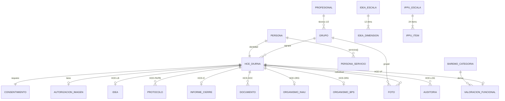

# Modelo de datos — HCE IPPU (PostgreSQL + JSONB)

> **Estado:** propuesta Fase 1, derivada del **Documento Técnico UTEC-LIDIA v1.0**
> (§6 Modelo de datos sugerido) y del prototipo `HCE_IPPU_Prototipo_v1.html`.
> **Motor:** PostgreSQL 13+ (probado en 18). Enfoque **mixto: relacional + JSONB**.

## 1. Por qué PostgreSQL + JSONB (enfoque mixto)

El §6 deja la implementación *«relacional, documental o mixta a criterio del equipo UTEC»*.
Para una **HCE con valor legal** (Ley 18.331/18.335) elegimos el enfoque mixto porque combina
lo mejor de ambos mundos:

| Se necesita… | Se resuelve con… |
| :-- | :-- |
| Integridad referencial persona → grupo → HCE → módulos | **Relacional** (claves foráneas) |
| Firma → bloqueo → auditoría en un solo paso | **Transacciones ACID** nativas |
| Auditoría inalterable y estadística agregada (§9) | **Tablas SQL** + triggers |
| Búsqueda por CI / N.º HC / grupo (§3.3) | **Índices** B-tree |
| Instrumentos anidados (12 dimensiones, 24 ítems, firmas, excepciones) | **JSONB** (encaje natural del §6) |
| Portabilidad institucional (§8.3) sin tocar código | **Tablas parametrizables** + JSONB flexible |

**Regla de reparto:** la *identidad y las relaciones* viven en columnas relacionales; el
*contenido de cada instrumento* vive en JSONB; los *totales derivados* se materializan en
columnas (validadas por trigger contra el detalle JSONB) para informes y estadística rápidos.

## 2. Mapa del §6 → esquema

| Entidad §6 | Tabla(s) | Notas de modelado |
| :-- | :-- | :-- |
| `persona {…, servicios[]}` | `persona` + `persona_servicio` | `servicios[]` → tabla puente (integridad) |
| `grupo {…, otros_tecnicos[]}` | `grupo` + `grupo_otro_tecnico` | roles con **etiqueta configurable** (`tecnico1_rol`) |
| `hce_diurna {…, anamnesis{}}` | `hce_diurna` | `anamnesis` en **JSONB** (HCE-00 siempre abierto) |
| `consentimiento` · `autorizacion_imagen` | idem (1:1 con HCE) | PK = `hce_id` |
| `idea {dim[12]{…}, firmas[2], excepciones[]}` | `idea` | `dimensiones` JSONB, totales en columnas |
| `protocolo {item[24]{…}, deltas(B)}` | `protocolo` | `items` JSONB, `deltas` solo B (B−A) |
| `informe_cierre {sint_escala[4], recibi_familia}` | `informe_cierre` | JSONB para arrays/estructuras |
| `documento` · `foto` | idem | `foto`: individual **o** grupal (CHECK) |
| `organismo_inau {envios[]}` · `organismo_bps {gestiones[]}` | idem | listas en JSONB |
| `valoracion_funcional {dominios{6}}` | `valoracion_funcional` | `categoria` **derivada** de `pct` |
| `auditoria {…}` | `auditoria` | **solo inserción** (trigger) |
| catálogos y parámetros | `idea_escala/dimension`, `ippu_escala/item`, `baremo_categoria`, `categoria_documento`, `vocabulario`, `recordatorio_config`, `config_institucion` | protocolo **data-driven** |
| usuarios/evaluadores | `profesional` | evaluador + usuario del sistema (§9) |

## 3. Diagrama (núcleo)

Los **puntajes** (12 dimensiones IDEA, 24 ítems IPPU-TEA) no son tablas de detalle: viven como
arrays JSONB dentro de `idea.dimensiones` / `protocolo.items`, indexados con GIN para consulta.

## 4. Reglas de negocio implementadas en la base (no solo en la UI)

El documento exige (§5.2, §9) que ciertas reglas vivan en la **lógica de datos**. Implementadas
con triggers y funciones en `03_funciones_triggers.sql`:

| Regla (documento) | Implementación | Verificado |
| :-- | :-- | :-- |
| Firma bloquea edición; corrección por addenda (§4.1) | `bloqueo_por_firma()`; addenda vía `SET LOCAL hce.modo='addenda'` | ✅ |
| Sin consentimiento no se firma nada (§4.2, único bloqueo) | `firma_requiere_ci()` en IDEA/protocolo/IC | ✅ |
| Habilitación excepcional con constancia obligatoria (§4.2) | `habilitar_excepcional()` → traza en HCE-LOG | ✅ |
| Totales IDEA 0–96 y por escala 0–24 (§5.1) | `idea_validar()` calcula y valida | ✅ |
| No se firma IDEA con NS/vacíos (§4.3) | `idea_validar()` | ✅ |
| Totales IPPU-TEA 24–120; obs obligatoria en 1/5 (§4.3, §5.2) | `protocolo_validar()` | ✅ |
| **Δ solo B − A; nunca entre instrumentos** (§5.2 regla dura) | `protocolo_validar()` deriva `deltas` únicamente en B | ✅ |
| Categoría del baremo **derivada del %**, jamás de puntajes clínicos (§7.5) | `vf_derivar_categoria()` (solo mira `pct`) | ✅ |
| Protección de imagen individual y grupal (§8.4) | `foto_proteccion_imagen()` | ✅ |
| Auditoría de solo inserción, inalterable (§3.2, §9) | `auditoria_inalterable()` (rechaza UPDATE/DELETE) | ✅ |
| Firma atómica (firma + bloqueo + HCE-LOG en una TX) | `firmar_modulo()` | ✅ |
| Secuencia **guiada, no impuesta** (§4.1) | `sugerencia_secuencia()` (informa, no bloquea) | ✅ |

> **No-homologabilidad estructural (§5.2):** IDEA (severidad 0–96) e IPPU-TEA (progreso 24–120)
> se guardan en tablas **separadas**, con escalas de rango distintas. La base **jamás** calcula
> un delta entre ambos ni deriva el % del baremo desde puntajes clínicos: `deltas` es una columna
> exclusiva de `protocolo` (B−A) y `categoria_id` deriva solo de `valoracion_funcional.pct`.

## 5. Portabilidad (§8.3)

Nada de IPPU está hardcodeado. Son **dato editable**: `config_institucion` (servicios, membrete),
`baremo_categoria` (rangos del Baremo), `categoria_documento`, `vocabulario` (constante
«severo / muy severo», §8.1), `recordatorio_config`, y las **etiquetas de rol** por grupo
(`tecnico1_rol` / `tecnico2_rol`). Otra institución adopta el sistema cambiando datos, no código.

## 6. Decisiones abiertas / notas para revisión

- **HCE por año vs. por persona.** Modelamos `hce_diurna` 1:1 con `persona` (reingreso reutiliza
  la identidad, §3.1); el ciclo anual se expresa en el `anio`/`fecha` de cada módulo. Si IPPU
  prefiere un expediente por ciclo lectivo, se cambia a `UNIQUE(persona_id, anio)`.
- **Confiabilidad interjueces (κ de Cohen, §9).** Las `firmas[]` ya guardan puntuaciones por
  evaluador con `tipo` (independiente/consenso); el cálculo de κ queda para Fase piloto (§12-D).
- **Migración (§10).** `idea.migrado_origen` y `documento.es_registro_historico` +
  categoría «Registro histórico — HCE anterior» ya están previstos.
- **Integración HCEN futura (§2, Decreto 242/017).** El modelo relacional facilita un mapeo
  posterior a FHIR/HL7 si se requiere.
