# Esquema de datos v2 — HCE IPPU (M11 · backend v2)

> **Versión del documento: v3** — 2026-09-03 (M12.8b-1); **completada el 2026-09-10 (M12.8b-1b): sección
> HCE-PAI (§2.2) + diagrama ER de §1**. Refleja el esquema tras **M12.0–M12.7 y M12.8a** (hasta M12.8a-3).
> ⚠️ **El archivo sigue llamándose `esquema-datos-v2.md` y no cambia**
> (`handoff.md` §5.81): «esquema v2» nombra la arquitectura del backend v2 —incluida la migración
> `559b1a79cb77_esquema_v2_inicial_m12_8a.py`—; lo que se versiona acá es el **documento**. No hay ningún
> archivo `esquema-datos-v3.md`.
>
> **Estado medido** (2026-09-03, contra `Base.metadata` y la base de desarrollo; **re-medido 2026-09-10 sin
> cambios**): **51 tablas** en `app/models/` (ateneo 2 · catalogos 13 · divulgacion 1 · identidad 5 ·
> inclusion 4 · modulos 6 · pai 8 · severidad 2 · transversales 10). Migración inicial **única**
> `559b1a79cb77` (`down_revision = None`, un solo archivo en `alembic/versions/`, 51 `op.create_table`).
> **432 tests en verde, 0 salteados.** Por la enmienda §5.19 (2026-08-14) la migración se regenera al
> cerrar **cada** sub-módulo, con `test_la_migracion_coincide_con_los_modelos` en verde. Origen histórico:
> **IMPLEMENTADO en M11.2** (2026-08-07, 28 tablas).
>
> ✅ **Cobertura: las 51 tablas.** La sección **HCE-PAI** (`pai` + 7 hijas, M12.6 · §2.2) se escribió en
> **M12.8b-1b** (2026-09-10) y el diagrama ER de §1 quedó completo. Antes de ese pase el documento describía
> 43 de 51.
>
> Deriva del **Documento Técnico IPPU v1.0** (§6 modelo sugerido) y del **modelo clínico ya
> validado en la demo v4.0** (ronda M0–M10). Toma `docs/markdown/modelo-datos.md` como punto de
> partida **con los bugs A y B corregidos** y las 3 decisiones de arquitectura cerradas (2026-07-30).
> Reemplaza a `esquema-datos.md` (v1, pre-Documento Técnico), **borrado el 2026-08-20** junto con
> `ejemplos-endpoints.md`: describían el backend v1, retirado entero en M11.2 (`handoff.md` §5.29).
> Este documento es la única fuente citable del esquema.
>
> **Fuente normativa desde ago-2026 (§5.10 / D1):** Manual de Procedimientos v1.0 + Prototipo v4 de
> IPPU, por encima del Documento Técnico. Decisiones de la ronda: `handoff.md` §5.10–§5.18.

## Registro de versiones del documento

El **archivo** (`esquema-datos-v2.md`) no se renombra nunca — «esquema v2» es la arquitectura del backend
v2, no un número de este texto (`handoff.md` §5.81). Lo que sigue es la versión del **documento**.

| Versión | Fecha | Qué refleja |
|---|---|---|
| v2 | 2026-07-30 → 2026-08-15 | Documento inicial del esquema v2 (propuesta del 2026-07-30, commit `d8d6533`), ampliado en los modelos y la migración por M12.0–M12.4 y M12.7. La última cabecera de estado quedó en M12.3 (**34 tablas**). |
| **v3** | **2026-09-03** (M12.8b-1) → **2026-09-10** (M12.8b-1b) | Puesta al día tras **M12.5** (HCE-INC), **M12.6** (HCE-PAI, solo esquema), **M12.7** (ateneos) y **M12.8a** (`ateneo.observaciones`, cinco nombres reales de grupo, `divulgacion`). Cambios de este pase, todos de **documentación** —no se tocó `app/`, `alembic/`, `tests/`—: cabecera y §3 al estado medido (**51 tablas**, migración `559b1a79cb77`); `grupo` con los **cinco nombres reales** (§5.61) en vez de los colores; `idea` descrito **como está en el modelo** (sin `anio`) con aviso explícito de I1 / §5.36 (el IDEA es anual por decisión, el modelo aún no); `ateneo.observaciones` (§5.66); **`divulgacion`** nueva en §2.3 + §1 + §4 (§5.80); esbozo de **`tecnico_grupo` como NO CONSTRUIDO** (§5.79); §12-A del plan reescrito en prosa (§5.65). **M12.8b-1b (2026-09-10)** agregó la **sección HCE-PAI completa** (§2.2 — 8 tablas / 81 columnas, medidas contra el modelo y la migración) y completó el **diagrama ER** de §1; también documentación pura. |

## 0. Decisiones de arquitectura aplicadas (cierran el Anexo A del plan)

| # | Decisión | Consecuencia en este esquema |
|---|---|---|
| 1 | **Postgres-only** (dev y prod vía docker-compose; se abandona SQLite en dev) | Se usa `JSONB` para el contenido de instrumentos y `CHECK`s reales. Una sola migración inicial limpia (el esquema v1 nunca tuvo datos reales). |
| 2 | **Lógica de negocio en el servidor** (Pydantic + servicios FastAPI), **sin triggers PL/pgSQL** | La BD guarda **integridad estructural** (FK, UNIQUE, CHECK de rango, XOR). Todas las reglas clínicas viven en Python, testeables con pytest (ver §4). |
| 3 | **Portabilidad = paramétrico mínimo** | Sólo catálogos que el Doc. Técnico exige como dato: `baremo_categoria` (§0.4), roles como texto (`tecnicoN_rol`), `recordatorio`, `categoria_documento`. **No** se construyen `config_institucion` ni `vocabulario`. |

**Bugs de `modelo-datos.md` corregidos:**
- **A.** `informe_cierre` era `||--o|` (a lo sumo uno en la vida del NNA) → pasa a **1:N** con `UNIQUE(hce_id, anio)`: es un informe **anual**, uno por ciclo, igual que `protocolo`.
- **B.** `PERSONA ||--|| HCE_DIURNA` (1:1 obligatorio) → pasa a **0..1** (`persona` puede existir sin HCE de Atención Diurna) + `persona_servicio` N:M para la identidad única transversal a servicios (§3.1). Taller Terapéutico y Clínica quedan reservados (Fase 2) sin forzar el modelo.

**Regla de reparto (heredada de `modelo-datos.md`, que estaba bien):** identidad y relaciones en
columnas relacionales; el contenido de cada instrumento (12 dimensiones, 24 ítems, firmas,
addendas, excepciones) en JSONB; los totales derivados se **materializan en columnas** — pero los
calcula y valida **el servidor** al guardar/firmar, no un trigger.

## 1. Diagrama ER (núcleo)

```mermaid
erDiagram
    PROFESIONAL ||--o{ GRUPO : "técnico 1/2"
    GRUPO       ||--o{ HCE_DIURNA : agrupa
    PERSONA     ||--o| HCE_DIURNA : "0..1 (bug B corregido)"
    PERSONA     ||--o{ PERSONA_SERVICIO : "servicios[] (§3.1)"
    SERVICIO    ||--o{ PERSONA_SERVICIO : ""
    HCE_DIURNA  ||--o| CONSENTIMIENTO : "HCE-CI (1:1)"
    HCE_DIURNA  ||--o| AUTORIZACION_IMAGEN : "§8.4 (0..1)"
    HCE_DIURNA  ||--o{ IDEA : "HCE-LB (1:N; hoy por reingreso >12m)"
    %% ⚠️ I1 (§5.36): el IDEA es ANUAL por decisión desde 2026-08-26 y el modelo
    %% aún no lo refleja (falta `idea.anio`). Ver la fila `idea` en §2.2 y la lista
    %% «DECIDIDO, SIN IMPLEMENTAR» de `handoff.md` §6.
    HCE_DIURNA  ||--o{ PROTOCOLO : "HCE-PA/PB (A|B × año)"
    HCE_DIURNA  ||--o{ INFORME_CIERRE : "HCE-IC (1 por año — bug A corregido)"
    HCE_DIURNA  ||--o{ DOCUMENTO : "HCE-DOC (XOR)"
    ATENEO      ||--o{ DOCUMENTO : "institucional (XOR)"
    %% La arista `HCE_DIURNA ||--o{ DOCUMENTO` **dejó de ser la única** en M12.7
    %% (§5.25): `documento.hce_id` pasa a nullable y aparece `ateneo_id`, con
    %% `CHECK(num_nonnulls(hce_id, ateneo_id) = 1)`. Motivo: un ateneo
    %% institucional o una jornada no tienen expediente, y el Prototipo v4 les
    %% pide adjuntos («Referencia a documentos en HCE-DOC **institucional**»).
    %% Se relaja la FK de la tabla dueña, como M12.1 hizo con `auditoria.hce_id`
    %% — no se crea una tabla paralela, que sería una segunda fuente de verdad
    %% sobre «documentos de la institución» (§5.20 · §5.22 · §5.24).
    HCE_DIURNA  ||--o{ FOTO : "individual"
    GRUPO       ||--o{ FOTO : "grupal (XOR)"
    HCE_DIURNA  ||--o{ ATENEO : "ateneo clínico — REFERENCIA (RESTRICT)"
    GRUPO       ||--o{ ATENEO : "sujeto (de grupo) · contexto (clínico)"
    PROFESIONAL ||--o{ ATENEO : "autor del registro"
    ATENEO      ||--o{ ATENEO_ACUERDO : "acuerdos (cascada)"
    %% `ATENEO` es el único vínculo hacia `HCE_DIURNA` que **no** es pertenencia:
    %% no cascadea, porque es historia institucional que referencia a un NNA. De
    %% ahí que la columna se llame `hce_referida_id` y no `hce_id` (§5.26).
    HCE_DIURNA  ||--o| ORGANISMO_INAU : "HCE-ORG (0..1)"
    HCE_DIURNA  ||--o| ORGANISMO_BPS : "HCE-ORG (0..1)"
    HCE_DIURNA  ||--o{ REGISTRO_ORGANISMO : "envíos INAU · gestiones BPS"
    HCE_DIURNA  ||--o| SEVERIDAD_DSM : "HCE-SEV (0..1, sin firma)"
    HCE_DIURNA  ||--o| INCLUSION : "HCE-INC (0..1, sin firma)"
    INCLUSION   ||--o{ INCLUSION_BITACORA : "gestiones del área (cascada)"
    ESTADO_INCLUSION ||--o{ INCLUSION : "estado semaforizado (FK por nombre)"
    %% `INCLUSION` es 0..1 **hoy** y por decisión reversible (§5.51): el estado de
    %% inclusión es una situación vigente, no un ciclo anual, y la historia del
    %% caso ya vive en `INCLUSION_BITACORA`. Lleva `id` propio + `UNIQUE(hce_id)`
    %% —y no `hce_id` como PK, como `SEVERIDAD_DSM`— justamente porque tiene tabla
    %% hija: así anualizarla es **soltar el UNIQUE**, sin repuntar una sola fila.
    %% `CATALOGO_CENTRO_EDUCATIVO` **no tiene arista**: `inclusion.centro` es
    %% texto sin FK (§5.52). Un centro educativo es una entidad externa y de
    %% mundo abierto — el catálogo no puede estar completo de antemano, y con FK
    %% obligatoria una pantalla de administración que falta se convierte en un
    %% registro clínico bloqueado. Mismo criterio que `pai_taller.taller_nombre`
    %% (§5.20), con fundamento propio.
    HCE_DIURNA  ||--o{ PAI : "HCE-PAI (0..N, sin firma — N por año)"
    PAI         ||--o{ PAI_OBJETIVO : "§X (cascada)"
    PAI         ||--o{ PAI_EVALUACION_PREVIA : "§IX — sólo actualizaciones (cascada)"
    PAI         ||--o{ PAI_EQUIPO : "§XV (cascada)"
    PAI         ||--o{ PAI_COORDINACION : "§XIII — 6 filas fijas (cascada)"
    PAI         ||--o{ PAI_TALLER : "§XI — por nombre, sin FK a TALLER (cascada)"
    PAI         ||--o{ PAI_PRESTACION : "§IV (cascada)"
    PAI         ||--o{ PAI_CIRCUITO : "§XIV (cascada)"
    %% `PAI` es pertenencia (`hce_id`, CASCADE, §5.26): N por expediente y **por
    %% año** (sin `UNIQUE(hce_id, anio)`, §5.22 — inicial + actualización semestral).
    %% El centro educativo/modalidad/grado (§V) y los puntajes de los instrumentos
    %% se leen EN VIVO de `INCLUSION` y de los módulos del flujo — no hay arista de
    %% copia. Módulo sin firma y SIN GUARDS (§5.54); los guards son M11.3. Ver §2.2.
    HCE_DIURNA  ||--o| VALORACION_FUNCIONAL : "HCE-VF (0..1)"
    HCE_DIURNA  ||--o{ AUDITORIA : "HCE-LOG (solo inserción)"
    HCE_DIURNA  ||--o{ OBSERVACION : "seguimiento"
    HCE_DIURNA  ||--o{ EVENTO : "alta/baja"
    %% `HCE_DIURNA }o--o{ TALLER` se retiró en M12.3 (§5.20): la participación
    %% no cuelga del expediente ni apunta a `taller.id` — es `pai_taller
    %% { pai_id, taller_nombre }`, por nombre y por PAI, y la crea M12.6.
    CATEGORIA_DOCUMENTO ||--o{ DOCUMENTO : clasifica
    BAREMO_CATEGORIA    ||--o{ VALORACION_FUNCIONAL : "deriva (sólo de pct)"
    IDEA_DIMENSION      ||--o{ IDEA_NIVEL : "descriptores 0–8"
    IDEA_DIMENSION      ||--o| IDEA_FICHA : "ayuda contextual (M12.1)"
    IDEA_DIMENSION      ||--o{ IDEA_EJEMPLO : "ejemplo clínico por nivel (M12.1)"
    %% `SEVERIDAD_NIVEL` (3 grados DSM-5-TR) es tabla de referencia **sin FK
    %% entrantes**: `severidad_dsm.nivel_cs/_crr` son el dato primario —el juicio
    %% clínico—, no una clasificación derivada, y el rango lo garantiza un CHECK.
    %% Mismo criterio que `taller` (M12.3) y que `idea` respecto de `banda_idea`.
    DOCUMENTO   ||--o| CONSENTIMIENTO : "adjunto"
    DOCUMENTO   ||--o| AUTORIZACION_IMAGEN : "copia firmada"
    HCE_DIURNA  ||--o{ DIVULGACION : "HCE-DIV — acto de divulgación (CASCADE)"
    ATENEO      ||--o{ DIVULGACION : "un dato puede salir de un ateneo (§5.25)"
    DOCUMENTO   ||--o{ DIVULGACION : "qué salió · y la autorización escrita (RESTRICT)"
    PROFESIONAL ||--o{ DIVULGACION : "responsable (RESTRICT)"
    %% `DIVULGACION` (M12.8a-3, §5.80): `hce_id` CASCADE con contra-argumentación
    %% registrada; el CHECK de pertenencia es num_nonnulls(hce_id, ateneo_id) <= 1
    %% (y no = 1) porque el informe agregado de §6.6 del Protocolo no pertenece a
    %% ningún expediente ni ateneo. Append-only por postura (sin UPDATE/DELETE),
    %% sin trigger, sin seed. Ver §2.3 y §4.
```



## 2. Tablas

### 2.1 Identidad y organización
| Tabla | Campos clave | Notas |
|---|---|---|
| `profesional` | id, nombre, especialidad, email **UK**, rol (`admin\|tecnico`), hashed_password (Fase 4), activo | ex-`terapeuta` de v1; también evaluador/firmante. |
| `persona` | id, nombre, apellido, ci **UK**, fecha_nac, sexo, localidad, referente, telefono, **+ metadatos de origen** | Identidad única transversal (§3.1). La edad se calcula. |
| `servicio` | id, clave (`atencion_diurna\|taller_terapeutico\|clinica`), activo | Los dos últimos reservados para Fase 2 (§0.3). |
| `persona_servicio` | persona_id FK, servicio_id FK, fecha_alta, fecha_baja | **UK**(persona, servicio). |
| `grupo` | **id serial** (identificador sin significado), **nombre** `varchar(60)` NOT NULL — **texto libre, sin CHECK** (valores reales: **Inicial · Escolares · Preadolescentes · Adolescentes · Taller de Adolescentes**, §5.61; el seed planta esas cinco filas), **anio SMALLINT**, **UK(nombre, anio)**, franja, dias, horario, tecnico1_id FK, **tecnico1_rol** (texto), tecnico2_id FK, **tecnico2_rol**, obs | **D9 (§5.18), confirmada 2026-08-14.** Un grupo por nombre **y por año**: «Escolares 2026» y «Escolares 2027» son dos filas. Roles = etiqueta configurable como dato (decisión 3 / §0.5). Ver la nota de abajo. ⚠️ **«Taller de Adolescentes»** se siembra como fila de `grupo` (§5.61); si IPPU lo entiende como el servicio de Taller Terapéutico (Fase 2) y no como un grupo, esa fila se retira — pregunta **A5** de `docs/notas/preguntas-ippu.md`. |

> **`grupo` — por qué el id es propio y la unicidad es `(nombre, anio)`** (D9, `handoff.md` §5.18;
> confirmada por el equipo el 2026-08-14, implementada en M12.1).
>
> Hasta M11.2 la PK era la letra (`A..E`), así que **un grupo existía una sola vez en toda la historia**:
> en 2027, crear el Grupo Escolares obligaba a sobrescribir la fila de 2026 —se perdía quiénes fueron sus
> técnicos ese año— y los expedientes de 2026 (`hce_diurna.grupo_id`) pasaban a apuntar silenciosamente
> al grupo del año nuevo. Con **id propio sin significado**, «Escolares 2026» y «Escolares 2027» son dos
> filas distintas y el vínculo de cada expediente no se mueve nunca. El `UNIQUE(nombre, anio)` impide el
> problema opuesto: dos filas «Escolares 2026» por error.
>
> **Granularidad anual, no por fecha.** Con fecha completa, «Escolares 2026-03-01» y «Escolares 2026-08-15»
> serían dos filas válidas y volvería a haber dos grupos Escolares en el mismo año. Además `anio` es la
> granularidad que este mismo documento ya usa en `protocolo` e `informe_cierre` para los ciclos anuales.
>
> **Los nombres van en la fila, sin catálogo aparte.** Los grupos reales de IPPU son **Inicial · Escolares
> · Preadolescentes · Adolescentes · Taller de Adolescentes** (§5.61, que confirma §5.37 / I2; los colores
> «Azul · Celeste · Naranja · Verde» eran ejemplos del Prototipo v4 y `A..E` era invención nuestra). Si en
> 2028 dejan de usar «Preadolescentes», la fila de 2026 lo sigue diciendo, y un catálogo de nombres sólo
> sería una tabla más que mantener. ⚠️ El alta / renombrado de grupos **desde la aplicación** (ADMIN abre
> el año nuevo) no existe todavía — `docs/notas/puntos-a-validar.md` §2.8.
>
> ⚠️ **Límite aceptado:** con granularidad anual, un **cambio de técnico a mitad de año** sobrescribe la
> fila y sólo queda rastro en `auditoria`. Modelar vigencias por técnico es bastante más caro y depende
> de las respuestas de IPPU a §3.6/§3.7 de `docs/notas/consulta-a-ippu.md` (eran §3.7/§3.8 antes de la
> revisión del equipo del 19/08 — `handoff.md` §5.34). Si responden que pasa
> seguido, se revisa.
| `hce_diurna` | id, persona_id FK **UK** (0..1), **hc_historico** (identificador secundario, §10), **grupo_id FK (entero)**, diagnostico, cie11, ~~nivel_soporte~~, dx_fecha, derivacion, medicacion, alerta, **anamnesis JSONB**, activo, fecha_baja, timestamps, **+ metadatos de origen** | HCE-00 siempre editable (sin firma). Un expediente por persona; los ciclos anuales viven en `protocolo.anio` / `informe_cierre.anio` (decisión abierta de `modelo-datos.md`, resuelta así). ⚠️ **`nivel_soporte` se retiró en M12.4** (`handoff.md` §5.24) — ver la nota de abajo. |
| ~~`hce_taller`~~ | ~~hce_id FK, taller_id FK~~ | **RETIRADA en M12.3** (`handoff.md` §5.20). Resto de v1: participación viva, por expediente y por `taller_id`. La especificación fija `pai_taller { pai_id, taller_nombre }` —por nombre y por instancia de PAI— y la construye **M12.6**; no hay nada preexistente que reusar. |

> ⚠️ **`hce_diurna.nivel_soporte` se retiró en M12.4** (`handoff.md` §5.24) — **una columna, no una tabla:
> el conteo no cambia por esto.** Con HCE-SEV iban a convivir **tres** lugares con un «nivel DSM». Quedan
> dos, y hay que no confundirlos:
>
> | Dónde | Qué es |
> |---|---|
> | `banda_idea.nivel_dsm` (M12.1 · D4) | Propiedad **de la banda**, no del NNA: «un total de 56–75 se corresponde orientativamente con Nivel 2». Contenido del catálogo del IDEA. **Se queda.** |
> | `severidad_dsm.nivel_cs` / `.nivel_crr` (M12.4) | **La evaluación actual de IPPU**: juicio clínico, por dominio, con justificación, fecha y autor. |
>
> **Se probó que `nivel_soporte` no era ninguna de las dos.** La hipótesis razonable —que fuera el nivel
> que trae el **diagnóstico externo**, dato histórico vecino de `diag` y `cie11` en las Especificaciones
> §3— quedó refutada por el HTML del prototipo: (1) HCE-00 lo rotula `Nivel de soporte DSM-5-TR
> (orientativo)`, sin ninguna referencia al ingreso; (2) el módulo `sev` **lo pisa en cada edición**
> (`setSev()` → `p.nivel = sevResumen(p);  // sincroniza la etiqueta visible de la ficha`), dejándole un
> string de otro formato (`"CS: Grado 2 · CRR: Grado 2"`); (3) la ficha nunca muestra dos niveles, hay un
> solo slot. Además el identificador `nivel_soporte` aparece **una sola vez en las 406 KB** del prototipo,
> en el «esquema **sugerido**» de Especificaciones §3, y la app nunca lo usa. Era la etiqueta visible
> denormalizada: una copia sin justificación, fecha ni autor de lo que `severidad_dsm` registra bien.
> **Divergencia declarada con la fuente normativa:** las Especificaciones lo listan y nosotros no lo
> implementamos, habilitado por el «Principio de la ronda» del plan M12.

> **Metadatos de origen (`OrigenMigracionMixin`, M12.1 · §10).** Cuatro columnas nullable en `persona`,
> `hce_diurna` e `idea`: **`sistema_origen`** (NULL = el dato nació acá), **`fecha_original`** (la que
> tenía en el sistema viejo), **`fecha_migracion`** y **`responsable_migracion`** (texto, no FK: quien
> firma el acta puede no ser usuario del sistema). Reemplazan al `idea.migrado_origen JSONB` de M11.2,
> que era la misma información en una bolsa sin forma —imposible de filtrar y sin garantía de que dos
> cargas usaran las mismas claves. La estrategia de migración de IPPU (sólo el IDEA estructurado, el
> resto legacy, acta de cierre, verificación por muestreo) no funciona si después no se puede distinguir
> lo migrado de lo cargado acá.

### 2.2 Módulos del flujo (CI → LB → PA → PB → IC)
Mixin común de firma (columnas en cada tabla de módulo): `firmado bool`, `firmas JSONB`
(lista `{profesional_id, rol, fecha}` — doble para LB/PA/PB/IC, familia para CI), `addendas JSONB`,
`excepcion JSONB` (`{motivo, texto, profesional_id, fecha}`). El **estado visible**
(`bloqueado|borrador|firmado`) **no se almacena**: lo deriva el servidor (mismo diseño sin drift
que la demo, M1).

| Tabla | Campos propios | Notas |
|---|---|---|
| `consentimiento` | **PK = hce_id**, firmante, fecha, **autorizaciones JSONB** (`{evaluacion, registro, comunicacion}`), documento_id FK (adjunto) | Único bloqueo sin excepción (§4.2): lo impone el servidor. |
| `idea` (HCE-LB) | id, hce_id FK, **dim JSONB** (12 × `{valor 0–8\|"NS", obs}`), fecha_consenso, sesiones, sintesis, objetivos, **manual_version**, **evaluador_t1_id / evaluador_t2_id FK** (M12.2), **+ metadatos de origen**, `total`, `esc_a..esc_d` (materializados) — **23 columnas medidas, SIN `anio`** | 1:N — hoy: reingreso >12 meses = instancia nueva; la vigente es la de mayor `fecha_consenso` (`app/models/modulos.py`, docstring de `Idea`). `CHECK(total BETWEEN 0 AND 96)`. **`manual_version`** (M12.1) persiste con qué manual se aplicó la evaluación (`core/constantes.py::IDEA_MANUAL_VERSION`); sin eso, corregir un descriptor reescribiría el criterio de todo lo ya firmado. **`evaluador_tN_id`** (M12.2 · D7): los dos técnicos que puntuaron por separado, con `CHECK` de que no sean la misma persona. <br>⚠️ **I1 · el IDEA es ANUAL por decisión desde el 2026-08-26 (§5.36) y el modelo todavía NO lo refleja** — no hay columna `idea.anio`. Está en la lista «🛑 DECIDIDO, SIN IMPLEMENTAR» de `handoff.md` §6; la puerta es **antes de M11.3** (§5.35). El costo está medido (§5.31 / R0): aditivo, `idea` ya es 1:N, 0 FKs a reconectar, 0 tests rotos con `anio` nullable. Lo caro no es la columna: es el selector de año en la demo y **la regla de «qué IDEA rige»**, que hoy vive en prosa como «la de mayor `fecha_consenso`» y con una instancia por año deja de ser la misma pregunta. **No inventar acá la columna: describir el modelo como está.** |
| `protocolo` (HCE-PA/PB) | id, hce_id FK, **tipo CHECK ('A','B')**, **anio**, fecha, semanas, **items JSONB** (24 × `{valor 1–5, obs}`), sint_tec1, sint_tec2, otros, ajustes (sólo B), **deltas JSONB** (sólo B; escribe el servidor al firmar B), **evaluador_t1_id / evaluador_t2_id FK** (M12.2), `total`, `esc_1..esc_4` | **UK**(hce_id, tipo, anio). `CHECK(total BETWEEN 24 AND 120)`. `CHECK(tipo='B' OR deltas IS NULL)`. `CHECK` de evaluadores distintos. |
| **`puntuacion_idea`** (M12.2 · D7) | id, idea_id FK, dimension_id FK, **valor_t1 / valor_t2** (0–8, nullable), **ns_t1 / ns_t2 bool**, **diferencia** (columna **generada**: `abs(valor_t1 - valor_t2)`), documentacion | **UK**(idea_id, dimension_id). Puntuación **independiente** de cada técnico, previa al consenso. El consenso **no se movió**: sigue en `idea.dim`. `NS` se representa con `ns_tN=true` + `valor_tN NULL` (`CHECK` de exclusión mutua), que lo distingue de «todavía no puntuó». |
| **`puntuacion_protocolo`** (M12.2 · D7) | id, protocolo_id FK, item_id FK, **valor_t1 / valor_t2** (1–5, nullable), **diferencia** (generada), documentacion | **UK**(protocolo_id, item_id). Igual que la anterior pero **sin `NS`**: la escala IPPU-TEA es Likert 1–5. |
| `informe_cierre` (HCE-IC) | id, hce_id FK, **anio**, fecha, **sint_escala JSONB** (4), val_tec1, val_tec2, recomendaciones, orientaciones, **recibi JSONB** (`{firmante, fecha}`) | **UK**(hce_id, anio) — bug A corregido. El PDF se genera desde acá: único informe válido (§5.3). |

> **M12.2 — puntuación independiente y consenso (D7 · `handoff.md` §5.16).** ⚠️ **Es el único cambio de
> toda la ronda M12 que NO sale del Prototipo v4.** El prototipo guarda un único array plano de consenso
> (`punt[12]`, `punt[24]`) y no tiene puntuación por evaluador en ninguna parte; declara kappa como
> requisito y no lo implementa. Lo agregamos porque el **Manual de Procedimientos v1.0** establece que los
> dos técnicos puntúan de forma independiente y después consensúan, y llama a ese circuito *el único
> requisito metodológico invariante* del instrumento — sin las dos puntuaciones no hay kappa (§23 del
> Manual). Se hace **ahora** porque después de M11.3 cuesta migración **más** reescritura de servicios.
>
> **Por qué tablas y no más claves dentro del JSONB.** El argumento de M11.2 —«el instrumento se lee y se
> escribe entero»— vale para el **consenso**, que por eso no se tocó, y no vale para el dato de
> confiabilidad: kappa se calcula **a lo ancho** (t1 vs. t2 de una dimensión sobre toda la cohorte, un
> `GROUP BY dimension_id`), «diferencias ≥2 sin documentar» es una consulta institucional y no un dato de
> un expediente, el evaluador es una FK que dentro de JSONB nadie garantiza, y `NS` necesita
> representación tipada. **Tampoco se hereda la forma del prototipo:** sus arrays planos son justamente lo
> que no sirve para esto.
>
> **Todo es nullable, y eso es requisito, no comodidad:** los históricos migrados y el seed espejo de la
> demo sólo tienen el consenso, y todavía no sabemos si los técnicos de IPPU ya puntúan por separado o si
> es práctica a introducir (pregunta abierta, `handoff.md` §7). Una evaluación con sólo el consenso es
> válida.
>
> **`diferencia` es columna generada; el umbral que la interpreta, no.** La base calcula `abs(t1 - t2)`
> —aritmética pura, sin contenido clínico, imposible de desfasar y consultable—; el **2** que la convierte
> en «ambigüedad clínica» vive en `core/constantes.py::CONSENSO_DIFERENCIA_AMBIGUEDAD`, no en la DDL. Es
> constante y **no catálogo paramétrico** (contra el criterio general de D6) a propósito: si el umbral se
> pudiera correr con un `UPDATE`, los kappas de antes y después no serían comparables. `procedimiento` y
> `documentacion_pendiente` son **derivados, no almacenados** (`hybrid_property`), mismo criterio que el
> estado visible de los módulos.

#### HCE-SEV · Severidad DSM-5-TR (M12.4) — módulo **sin firma**
Va en `app/models/severidad.py`, archivo propio: no es parte del flujo firmable y no comparte nada con él.
En el orden de la ficha va **entre CI e IDEA** (`FICHA_TABS` del Prototipo v4: `ci · sev · idea`). Ese
orden **no está modelado en ninguna tabla** y no se inventa una — queda para **M11.4**, que es donde se
define la navegación.

| Tabla | Campos propios | Notas |
|---|---|---|
| **`severidad_dsm`** | **PK = hce_id**, `nivel_cs` (1–3), `nivel_crr` (1–3), `justificacion`, `fecha`, `profesional_id` FK | **0..1 por expediente**, como `consentimiento`. Sin firma, siempre editable. |

- **Los dos dominios son independientes.** CS 3 con CRR 1 es un perfil corriente y nada en el modelo los
  ata. «Independientes» es sobre sus **valores**: los dos son NOT NULL, porque la regla dice que la
  severidad «se especifica por separado para **cada** dominio» y una fila con un dominio en blanco sería
  una afirmación a medias. El estado «todavía no se juzgó» ya es representable **sin fila** — eso es lo
  que compra el 0..1 —, así que columnas nullable serían una segunda forma de decir lo mismo.
- **`justificacion`, `fecha` y `profesional_id` son NOT NULL**, y la justificación además no puede estar
  vacía (`CHECK justificacion ~ '[^[:space:]]'`; `btrim()` a secas recorta sólo espacios y dejaba pasar
  tabuladores). Sin justificación no hay forma de distinguir un juicio clínico de una derivación que
  alguien hizo a ojo desde el IDEA — que es justo lo que la regla dura del módulo prohíbe. Que el
  profesional esté **habilitado** para diagnosticar es permiso (Fase 4), no integridad.
- **Las etiquetas no se guardan.** «Grado 2 · Necesita ayuda notable» se **deriva** del número contra
  `severidad_nivel`. Guardarla acá sería reintroducir el campo que se acaba de retirar de `hce_diurna`.
- **Sin FK a `severidad_nivel`, a propósito.** `nivel_cs`/`nivel_crr` son el **dato primario** —el juicio
  clínico—, no una clasificación derivada de otra cosa, y el grado DSM-5-TR vale aunque la tabla de
  descriptores esté vacía. Mismo criterio que `idea` respecto de `banda_idea`, y distinto de
  `valoracion_funcional.categoria_id`, que **sí** es FK porque ahí la categoría la deriva el servidor
  desde `pct`.

> ⚠️ **Por qué 0..1 y qué lo condiciona.** Dos razones: (a) la regla del módulo dice que el registro
> describe la necesidad de apoyo **actual** — que la severidad fluctúe no pide una fila por medición, pide
> que la fila diga **cuándo** se juzgó; (b) **es la dirección reversible**: 0..1 → 1:N es agregar un `id` y
> soltar la PK, sin perder filas; 1:N → 0..1 obliga a elegir una fila por expediente y descartar el resto.
>
> **Esto es correcto sólo con el guard de auditoría de §4.** «La historia vive en `auditoria`» es hoy una
> aspiración: no existe `app/services/`, así que nada garantiza todavía que un UPDATE escriba
> `campo`/`valor_ant`/`valor_nuevo`. Con esa línea escrita, 0..1 es correcto; **sin ella, borra en silencio
> la fluctuación que la propia regla menciona como propiedad del fenómeno.**
>
> Si IPPU responde que la severidad se re-evalúa en una instancia fija (al cierre anual, junto con el
> IDEA), esto pasa a 1:N con `anio`. Anotado en `docs/notas/puntos-a-validar.md` §1.

> ⚠️ **Restricción de UX conocida, para M11.4 — no reabre la decisión.** Que los dos dominios sean NOT
> NULL significa que **no hay guardado parcial**: un técnico que ya juzgó CS pero todavía no CRR **no puede
> grabar**. Es defendible —el DSM-5-TR pide especificar los dos, y el prototipo mismo trata el registro
> como una unidad— pero **este módulo no tiene borrador ni firma**, así que a diferencia de LB/PA/PB/IC
> **no hay estado intermedio donde apoyar el a medias**. Quien haga el router tiene que decidirlo de forma
> explícita, y las opciones son:
>
> 1. **La UI valida antes de enviar** y el registro se crea completo (lo más simple, y lo que hace el
>    prototipo: los dos `<select>` están en el mismo formulario).
> 2. **Borrador del lado del cliente** hasta que estén los dos, sin tocar el modelo.
> 3. Si IPPU dice que juzgar un dominio y el otro después es práctica real, **volver nullable las dos
>    columnas** — es un cambio de una línea, pero hay que aceptar entonces que «fila con un dominio en
>    blanco» y «sin fila» pasan a significar casi lo mismo, y definir cuál usa el sistema.
>
> **Se anota, no se decide acá:** es una pregunta de flujo de trabajo, y M12 es capa de modelo.

#### HCE-INC · Inclusión educativa y social (M12.5) — módulo **sin firma**
Va en `app/models/inclusion.py`, archivo propio, por el mismo motivo que `severidad.py`. Registra la
situación educativa del NNA **fuera de IPPU** y la bitácora de todas las articulaciones. En palabras de la
fuente, «sustituye la práctica de adjuntar reportes individuales de texto libre»; **los reportes históricos
del área quedan en HCE-DOC** como archivo de solo lectura — de ahí que la bitácora **no tenga backlog de
migración**, que es lo que permite que `tema` sea NOT NULL.

| Tabla | Campos propios | Notas |
|---|---|---|
| **`inclusion`** | `id` PK, **`hce_id` FK CASCADE UNIQUE**, `centro` (**texto, sin FK**), `tipo_centro`, `grado`, `modalidad`, `dias_horas`, `at`, `at_nombre`, `ref_nombre`, `ref_rol`, `ref_tel`, **`estado` FK→`estado_inclusion.nombre`** (`RESTRICT` + `ON UPDATE CASCADE`, `server_default 'Sin registrar'`, indexado), `fecha_estado` (indexado), `obs`, `creado_en`, `actualizado_en` | **0..1 por expediente** (§5.51). Sin firma, siempre editable. CHECK de dominio en `tipo_centro` y `at`. |
| **`inclusion_bitacora`** | `id` PK, `inclusion_id` FK **CASCADE**, `fecha`, `interlocutor` (CHECK no vacío), `rol`, `medio`, **`tema` NOT NULL** (indexado), `contenido` (CHECK no vacío), `acuerdos`, `autor_id` FK nullable, `registrado_en`. **`sensible` es derivado**, no columna | Índice compuesto `(inclusion_id, fecha)`: cubre la FK **y** la columna «última gestión» del tablero, que es un `max(fecha)` por ficha. |

- **`id` propio y no `hce_id` como PK — refina el patrón de `severidad_dsm`, no lo contradice.** La
  diferencia es que esta ficha **tiene tabla hija**: con la PK en `hce_id`, pasar a una ficha por año
  obligaría a repuntar cada fila de `inclusion_bitacora` y reconstruir su FK. Con `id` serial +
  `UNIQUE(hce_id)`, anualizar es **soltar una restricción**: cero movimiento de datos.
- **`hce_id` es pertenencia** (§5.26): sin calificador, `ondelete="CASCADE"`.
- **⚠️ Contrato de nombres con M12.6.** `centro`, `modalidad` y `grado` **se llaman así y no se renombran**:
  la sección V del PAI las lee **en vivo** desde acá (§5.22), no las copia. Fijado por
  `test_el_contrato_de_nombres_con_m12_6_se_mantiene`. Si se mueven, la sección V del documento que se le
  entrega a INAU queda en blanco sin que nada falle.
- **`at` no es booleano.** Tres valores: `No` · `Sí` · `En trámite (lista de espera)`. El tercero es
  información de gestión —hay un trámite abierto— que un `bool` perdería. ⚠️ **No estaba declarado como
  catálogo en la fuente**: los tres valores están inline en el `<select>` de `mInc()`. Es el tercer caso de
  la tabla de §5.50 y por eso queda escrito acá.
- **`at` nace NULL, no en `'No'`** — divergencia declarada con el prototipo. «No tiene acompañante» es una
  afirmación sobre el NNA; que un formulario en blanco la haga por defecto es un artefacto de UI.
- **`tema` es NOT NULL, y es la única obligación que este módulo agrega** sobre lo que valida `incAdd`
  (fecha · interlocutor · contenido). Motivo: de `tema` se deriva `sensible`, y con NULL la derivación
  devolvería «no sensible» —el valor peligroso— **por omisión y no por decisión**.
- **`rol` y `medio` son opcionales pero acotados.** Opcionales porque el `<select>` preseleccionado del
  prototipo es un artefacto del widget y `incAdd` no los exige; acotados porque el módulo existe para dar
  indicadores del área, y con texto libre «WhatsApp» y «wsp» son dos categorías distintas.

> **`sensible` es derivado, nunca capturado.** `sensible = (tema == 'Clínica — sensible')`, con
> `hybrid_property` **y expresión SQL**, para que `WHERE NOT sensible` se resuelva en la base — un filtro
> de acceso aplicado después de leer ya leyó lo que no debía. Mismo criterio sin drift que `Taller.activo`
> (§5.20) y `Ateneo.sensible` (M12.7).
>
> ⚠️ **Qué significa hoy, dicho sin eufemismo: es una clasificación SIN EFECTO.** Significa **restringida
> para COMPARTIR, no para GUARDAR** — guardar el dato no requiere autorización, compartirlo sí (I4 ·
> §5.39 y I10 · §5.45). El prototipo lo dice en el mismo sentido: esas entradas «son **visibles** sólo
> para los técnicos responsables del grupo, el área de Inclusión, coordinación y dirección técnica».
> **Pero el modelo no tiene dónde aplicarla:** R0 verificó que el esquema representa el almacenamiento y
> **no representa la divulgación** — no hay columnas ni tablas de compartición, destinatario, exportación
> o entrega en todo `app/`. Esa capa es más grande que este módulo y §5.39 la pone **antes de
> M11.3/M11.4**. Acá queda sólo la clasificación, para que el día que exista el filtro tenga contra qué
> filtrar.

> **Por qué 0..1 y no una ficha por año** (§5.51, y es la pregunta que §5.35 dejó abierta a propósito).
> **IPPU no la contestó**: la reunión del 21/08 respondió que el **IDEA** es anual (§5.36), que es otra
> pregunta. Tres razones: (a) **la historia ya está modelada y no es esta tabla** — la bitácora es 1:N y
> fechada; anualizar la ficha daría dos fuentes de verdad sobre «cómo venía la inclusión en 2025»;
> (b) `fecha_estado` **se reescribe** en cada cambio en vez de acumular filas, y `p.inc` es un objeto y no
> un array: el patrón anual del esquema se aplica a **ciclos**, y esto es un **estado**; (c) es la
> dirección reversible, igual que `severidad_dsm`.
>
> ⚠️ **Y aplica la misma condición que HCE-SEV:** con una sola fila, cambiar de centro **pisa** el
> anterior y el rastro queda sólo en `auditoria`, que hoy es una aspiración. El guard **«toda edición de
> `inclusion` registra auditoría de campo»** está en §4. En la práctica el cambio **sí queda narrado en la
> bitácora**, que es donde el área lo escribe. Pregunta abierta en `docs/notas/puntos-a-validar.md` §1.15.

> **`centro` es texto y `estado` es FK — la asimetría es deliberada** (§5.52). No es incoherencia: **es de
> quién es el dominio.** Los 7 estados son una clasificación **cerrada e interna** del área, así que un
> valor fuera de la lista es un error de tipeo → FK con `RESTRICT` (no se borra un estado en uso) y
> `ON UPDATE CASCADE` (renombrarlo se propaga). Un centro fuera del catálogo **es una escuela real que
> todavía nadie cargó** → texto. Con FK obligatoria, el área no podría registrar la escuela a la que el
> NNA ya entró hasta que alguien la dé de alta — y hoy **no existe pantalla que dé de alta nada**
> (`puntos-a-validar.md` §2.8 y §2.9).

> **El tablero del área es M11.3/M11.4, no esto.** Acá se garantizan los datos y los índices: `estado` y
> `fecha_estado` sobre `inclusion` (los que pide el plan) y `(inclusion_id, fecha)` sobre la bitácora, del
> que salen la columna «última gestión» y la alerta de **60 días sin gestiones** — cuyo umbral ya vive
> como fila de `recordatorio` (clave `inc`, M12.1) y **no bloquea nada** (§4).

#### HCE-PAI · Propuesta de Atención Individual (M12.6) — módulo **sin firma**

Va en `app/models/pai.py`, archivo propio, por el mismo motivo que `severidad.py` e `inclusion.py`: no es
parte del flujo firmable, no es catálogo y no es un transversal del expediente. Digitaliza el **Formulario
PAI de IPPU**, escrito contra la pauta de INAU —quince secciones, de la identificación del NNA al equipo
que elabora la propuesta—. Es **el documento que se entrega a un organismo del Estado**, y de ahí sale casi
toda la forma del módulo.

⚠️ **Nombre oficial: «Proyecto de Atención Integral»** (el de INAU), no «Propuesta de Atención Individual»
del prototipo (§5.42 / I7, `puntos-a-validar.md` §1.11 CERRADO). La tabla se llama `pai` en cualquier caso
—el nombre no toca el esquema—, pero **va impreso en lo que se entrega a INAU**: importa para el PDF de
M11.4.

Construido en **M12.6** (2026-09-02) en **modo solo esquema** (§5.54): tablas, columnas y dominios; **sin un
solo guard** (ver el recuadro al final). En el orden de la ficha del Prototipo v4 (`FICHA_TABS`) va **entre
HCE-ORG y HCE-VF** (`… org · pai · vf · log`); ese orden **no está modelado** y no se inventa una tabla para
él — es **M11.4**, como en HCE-SEV.

**8 tablas · 81 columnas** (medidas contra `Base.metadata` y la migración `559b1a79cb77`, 2026-09-10): la
cabecera `pai` (43) y siete hijas que cuelgan de `pai_id` con `ON DELETE CASCADE` — `pai_objetivo` (9),
`pai_evaluacion_previa` (7), `pai_equipo` (6), `pai_coordinacion` (7), `pai_taller` (3), `pai_prestacion`
(3), `pai_circuito` (3).

| Tabla | Campos propios | Notas |
|---|---|---|
| **`pai`** | `id` PK · **`hce_id` FK `hce_diurna` `CASCADE`, index** (pertenencia, §5.26) · *cabecera:* `tipo` (`PAI_TIPOS`), `anio` (**Integer**, index), `fecha` · *§I:* `ingreso_ippu` · *§II:* `padron_inau`, `disposicion` (`PAI_DISPOSICIONES`), `judicial` (`PAI_SI_NO`), `expediente`, `derivado_por`, `motivo` · *§III:* `responsable`, `tel`, `nucleo`, `referentes` · *§IV:* `cobertura`, `controles` (`PAI_CONTROLES`), `tratamientos`, `medicacion`, `prest_obs` · *§V:* `apoyos_ed`, `otras_ed` · *§VI:* `sint_lb`, `delta_interp` · *§VIII:* `intereses_nna`, `voz_nna`, `expect_familia`, `acuerdo` (`PAI_ACUERDO_FAMILIA`), `fecha_devol` · *§XI:* `frecuencia` (`PAI_FRECUENCIAS`), `etapa` (`PAI_ETAPAS`), `otras_act` · *§XII:* `dinamica`, `ingresos` (**texto**), `vivienda`, `redes`, `pronostico` · *§XIV:* `f_rev`, `f_anual`, `criterios` · `creado_en`, `actualizado_en` | **N por expediente, NO anual**: tiene `anio` pero **sin `UNIQUE(hce_id, anio)`** (§5.22) — conviven el PAI inicial y su actualización semestral, que es lo que evalúa la §IX. **7 CHECK** de dominio (`tipo`, `disposicion`, `judicial`, `controles`, `acuerdo`, `frecuencia`, `etapa`), generados desde la constante con `_dominio()`. **39 «campos propios»** = 43 − `id` − `hce_id` − `creado_en` − `actualizado_en`. Todo lo demás **nullable**: un PAI en elaboración es un estado real. **`ingresos` es texto y no número** (el formulario los describe en prosa). Única tabla del módulo con `creado_en`/`actualizado_en`. |
| **`pai_objetivo`** (§X) | `id` PK · `pai_id` FK `CASCADE`, index · `area` (`PAI_AREAS`, **index**) · `objetivo` · `estrategias` · `indicador` · `responsable_rol` (**texto, no FK**) · `plazo` (`PAI_PLAZOS`) · `orden` (default 0) | **El corazón del módulo**: lo que el PAI compromete, congelado por instancia (§5.22). Tabla y no JSONB porque «objetivos por área», «qué vence este trimestre» y «PAIs sin objetivo de comunicación» son consultas **entre** propuestas. `responsable_rol` es rol y no FK a `profesional`: un objetivo sobrevive a que la persona deje la institución. **2 CHECK** (`area`, `plazo`). |
| **`pai_evaluacion_previa`** (§IX) | `id` PK · `pai_id` FK `CASCADE`, index · `objetivo` (**texto transcrito, no FK a `pai_objetivo`**) · `logro` (`PAI_LOGROS`) · `comentario` · `decision` (`PAI_DECISIONES`) · `orden` (default 0) | La bisagra entre un PAI y el siguiente. `objetivo` es **texto y no FK a propósito**: el documento entregado a INAU tiene que conservar el objetivo *como se evaluó*, no como diga hoy la fila apuntada (mismo criterio de robustez que `pai_taller`, §5.20). Que sólo aplique a «Actualización anual» **es un guard** (el prototipo la esconde con `esAct`) → M11.3. **2 CHECK** (`logro`, `decision`). |
| **`pai_equipo`** (§XV) | `id` PK · `pai_id` FK `CASCADE`, index · `nombre` (**texto, no FK**) · `rol` (texto libre) · `participo` (`PAI_SI_NO`) · `orden` (default 0) | Los dos técnicos responsables **no se guardan acá** (se leen de HCE-00 con `ro()`). Esta tabla es para el resto del equipo y el propio NNA, que la pauta pide incluir «en lo posible» — puede no ser usuario del sistema, de ahí `nombre` texto. **1 CHECK** (`participo`). |
| **`pai_coordinacion`** (§XIII) | `id` PK · `pai_id` FK `CASCADE`, index · **`actor` NOT NULL** (`PAI_COORDINACION_ACTORES`) · `se_coordina` (`PAI_SI_NO`) · `frecuencia` (frase libre) · `contenido` · `orden` (default 0) · **`UNIQUE(pai_id, actor)`** | **Seis filas fijas**, no lista abierta: el prototipo precarga los seis actores y no deja agregar ni quitar — la tabla registra **respuestas a un cuestionario cerrado**. `actor` es el único CHECK NOT NULL del módulo, y puede serlo porque el valor viene precargado, no lo elige el usuario. Crear las seis al abrir el PAI es trabajo del servicio (M11.3). **2 CHECK** (`actor`, `se_coordina`). |
| **`pai_taller`** (§XI) | `id` PK · `pai_id` FK `CASCADE`, index · **`taller_nombre` NOT NULL, `String(80)`, index** · **`UNIQUE(pai_id, taller_nombre)`** | Participación en talleres **por nombre, sin FK a `taller`** (§5.20 / §5.21, que M12.6 hereda; forma fijada por `apartado-especificaciones-tecnicas-prototipo-v4.md:50`). D5 (§5.14): agregar, reordenar o **retirar** un taller no puede alterar lo registrado. `pai_id` y no `hce_id`: la oferta cambia por período, así que «en qué talleres participa» sólo tiene respuesta dentro de un PAI. `String(80)` = el largo de `taller.nombre`. **Sin CHECK**: poner uno derrotaría la robustez que es el punto — no es un dominio «sólo-documentación», es una ausencia deliberada. |
| **`pai_prestacion`** (§IV) | `id` PK · `pai_id` FK `CASCADE`, index · **`prestacion` NOT NULL** (`PAI_PRESTACIONES`) · **`UNIQUE(pai_id, prestacion)`** | Una fila por ítem marcado. **El valor, no el índice**: el prototipo marca por posición (`P.prest[ix]`) y esa forma no se copia. **1 CHECK** (`prestacion`). Ver el recuadro sobre la tensión con HCE-ORG (§5.57). |
| **`pai_circuito`** (§XIV) | `id` PK · `pai_id` FK `CASCADE`, index · **`item` NOT NULL** (`PAI_CIRCUITO`) · **`UNIQUE(pai_id, item)`** | Una fila por ítem del circuito institucional de seguimiento que la propuesta se compromete a cumplir. Mismo criterio de forma que `pai_prestacion`; **compromiso, no diagnóstico** → se congela por instancia (§5.22). **1 CHECK** (`item`). |

- **`hce_id` es pertenencia** (§5.26): sin calificador, `ondelete="CASCADE"` — el PAI es contenido del
  expediente y muere con él. Las hijas cuelgan de `pai_id` (no de `hce_id`): son contenido **de esta
  propuesta**. `test_toda_hija_cuelga_del_pai_y_no_del_expediente` lo fija.
- **`pai` NO lleva `UNIQUE(hce_id, anio)`** (§5.22), y es la diferencia deliberada con `informe_cierre`: el
  PAI de INAU es un documento dinámico con revisión semestral, así que un mismo año tiene el PAI inicial y
  su actualización. Un `UNIQUE` haría que la actualización **pisara** el documento contra el cual la §IX
  evalúa. `test_conviven_dos_pai_del_mismo_anio_en_el_mismo_expediente`.
- **Reparto congelado / en vivo** (§5.22): lo que la propuesta **compromete** se congela por instancia
  (objetivos, coordinaciones, circuito, talleres del período; la firma marca el inicio de esos
  compromisos); lo que es **diagnóstico de situación** se lee en vivo y **no es columna de acá** — el
  centro educativo, `modalidad` y `grado` (§V) se leen de `inclusion` (M12.5, contrato de nombres en su
  docstring, `test_el_contrato_de_nombres_con_m12_6_se_mantiene`); los puntajes de los instrumentos, el Δ,
  la severidad y el grupo se leen de sus módulos. `test_pai_no_copia_ningun_dato_que_se_lee_en_vivo`.
- **«Sección de carga única» no existe: la carga es por campo** (§5.55 / L2, que arbitra por §5.50 / J1 —
  el código ejecutable manda sobre la prosa de la misma fuente). La prosa de
  `prototipo-v4-referencia.md:166` generalizaba que las secciones I, II, VI, XI y XV «se renderizan con
  `ro()`» y hay que modelarlas como referencia; medido contra el código es **falso para cuatro de las
  cinco**. Son columnas propias de `pai`: `ingreso_ippu` (§I); `padron_inau`, `disposicion`, `judicial`,
  `expediente`, `derivado_por`, `motivo` (§II — HCE-ORG no tiene dónde guardarlos: su objeto es
  `inau:{sipi, convenio, referente, ingreso, obs, envios[]}`); `sint_lb`, `delta_interp`, `frecuencia`,
  `etapa`, `otras_act` (§VI y §XI — los puntajes se leen, la interpretación clínica se escribe). Sólo son
  referencia `sipi`, `convenio` y el diagnóstico (§II), y la §XV entera para los dos técnicos
  responsables. `test_los_campos_editables_de_las_secciones_i_y_ii_son_columnas_propias`.
- **§VII (FODA) se retiró** (§5.42 / I7, ratificado por §5.59): IPPU pidió sacar el «Análisis
  estratégico». M12.6 la había escrito igual (`fort`/`oport`/`debil`/`amen`, cuatro `Text`) sin cruzarla
  contra la decisión de cliente; las cuatro columnas salieron en **M12.8a-1** y la cifra de campos propios
  pasó de 43 a **39**. El comentario `── §VII · … RETIRADA ──` queda en el modelo para que la sección no se
  reincorpore sin volver a cruzar la decisión.
- **Dominios enum-like: todos con CHECK generado desde la constante** (`_dominio()` en `pai.py`,
  `test_el_check_y_la_constante_no_pueden_divergir`). **No hay dominios sólo-documentación** como el
  `grupos_orientados` de `taller` (§2.4): las **16 restricciones de dominio** del módulo (7 en `pai`, 9 en
  las hijas) están todas en la DDL. Las únicas columnas «de vocabulario» sin CHECK son texto libre por
  decisión de la fuente (`pai_equipo.rol`, `pai_coordinacion.frecuencia`, `pai_objetivo.responsable_rol`)
  y `pai_taller.taller_nombre`, cuya falta de CHECK **es** el diseño (§5.20).
- **`PAI_AREAS` (9), `PAI_PRESTACIONES` (6) y `PAI_CIRCUITO` (4) son constantes con CHECK, no catálogos**
  (§5.56 / L3 — ahí `PAI_PRESTACIONES` se cita con el nombre `PAI_PREST`). Criterio ya escrito y evidencia
  del propio prototipo: `CAT_TALLERES` tiene 4 funciones de gestión, estas tres tienen **cero**. Viven en
  `app/core/constantes.py`.
- **Sin patrón XOR ni polimórfico, sin timestamps en las hijas.** `pai` tiene una sola FK (`hce_id`) y cada
  hija una sola (`pai_id`); no hay `num_nonnulls()` en el módulo. `creado_en`/`actualizado_en` están **sólo
  en `pai`** — es 1 de las 3 tablas del esquema que las llevan (con `hce_diurna` e `inclusion`); las siete
  hijas no tienen marca temporal propia (la deuda de convención de timestamps de todo el esquema está en
  §4, fila «M12.7 · autoría y timestamps»).

> ⚠️ **HCE-PAI NO IMPONE NADA — ningún guard** (§5.54, modo solo esquema; los guards son **M11.3**, que
> toma Lucas, §5.67). Hoy la base **no** hace cumplir: la secuencia respecto de los instrumentos; que la
> §IX («Evaluación del PAI anterior») sólo exista en un PAI de tipo «Actualización anual»; el **Anexo A**
> del Manual (cálculo de totales y deltas con verificación previa a la firma — es M11.3, no esquema,
> §5.54); **«qué IDEA rige»** a la fecha del PAI (§5.35 pone esa regla antes de M11.3); las seis filas de
> `pai_coordinacion` precargadas al abrir; la compuerta «revisado por dirección → entregado» para lo que se
> entrega a un organismo (§2.13, junto con §5.71). El módulo **no tiene firma** —no lleva `FirmaMixin`—
> porque el objeto `pai` del Prototipo v4 es el único del expediente sin `estado`, y las tres líneas de
> firma de la §XV son rótulos de impresión. **Un lector no debe concluir de esta sección que el módulo
> valida secuencia, completitud ni bloqueo.**

> **Dos secciones del Manual siguen sin identificar: §4 y §8** (`docs/notas/puntos-a-validar.md` §1.16). El
> Manual de Procedimientos v1.0 tiene 25 secciones y **no está en el repo**; se trabaja con la versión de
> consulta que el Prototipo v4 embebe (`const MANUAL`), que cubre 23. **Ninguna de las dos es del PAI** —el
> Manual no tiene una Parte del PAI; §4 cierra «Marco general» y §8 es un paso interno del IDEA— y por eso
> M12.6 pudo escribirse (§5.54). Es un **hueco conocido**, no una omisión de esta sección: si al
> identificarlas resultaran tocar el PAI, se revisa lo construido.

> **`pai_prestacion` es una excepción declarada a §5.22, no un descuido** (§5.57 / L4). Por el reparto de
> §5.22, «prestaciones y certificaciones vigentes» es diagnóstico de situación y debería leerse en vivo;
> pero **no hay de dónde**: `organismo_bps` guarda **una sola** `prestacion` en texto libre (0..1 por
> expediente), no un conjunto, y dos de los seis ítems —la Valoración Funcional y el certificado de
> discapacidad— **no son prestaciones BPS**. El equipo ratificó la **salida 2**: `pai_prestacion` queda
> como **declaración fechada** del PAI, no como copia sincronizada. El aviso de divergencia contra una
> tabla de equivalencias `BPS_PRESTACIONES` ↔ `PAI_PRESTACIONES` se reabre en M11.3/M11.4 si conviene.

> **Fuente para estas 8 tablas:** `app/models/pai.py` (docstrings por clase), `tests/test_m12_pai.py`, la
> bitácora de M12.6 en `docs/bitacora.md`, y las decisiones `handoff.md` §5.14, §5.20–§5.23, §5.26,
> §5.54–§5.57, §5.59.

### 2.3 Transversales (DOC · ORG · VF · LOG)
| Tabla | Campos clave | Notas |
|---|---|---|
| `documento` | id, **hce_id FK nullable / ateneo_id FK nullable + `CHECK(num_nonnulls(hce_id, ateneo_id)=1)`**, categoria_id FK, nombre, fecha_original, fecha_carga, **es_registro_historico bool**, archivo_ref (storage real: Fase 6) | Histórico (§10) = inmutable: el servidor rechaza UPDATE/DELETE — **la regla no cambia con el alcance institucional**, porque se apoya en `es_registro_historico` y no en `hce_id`. **M12.7 · §5.25:** el documento cuelga de un expediente **o** de un ateneo, nunca de los dos ni de ninguno. Antes `hce_id` era NOT NULL y un ateneo institucional o una jornada —que no tienen expediente— no podían tener adjuntos, contra lo que pide el propio Prototipo v4. Se relaja la FK de la tabla dueña, como M12.1 con `auditoria.hce_id`; una tabla paralela habría sido una segunda fuente de verdad. El XOR además conserva el invariante «no hay documentos huérfanos» que daba el NOT NULL. ⚠️ `categoria_documento` **no se tocó** (está en `DESDE_LA_DEMO`): un documento institucional usa «Otro» hasta M12.8. |
| `autorizacion_imagen` | **PK = hce_id**, registrada bool, fecha, documento_id FK (copia firmada) | Condición §8.4 para `foto`. |
| `foto` | id, **hce_id nullable / grupo_id nullable + `CHECK(num_nonnulls(hce_id, grupo_id)=1)`**, descripcion, fecha, archivo_ref | Individual: exige autorización del NNA; grupal: de **todas** las familias activas del grupo — ambas en el servidor (§4). |
| `organismo_inau` | **PK = hce_id**, sipi, convenio, referente, ingreso, obs | |
| `organismo_bps` | **PK = hce_id**, prestacion, tramite, estado, vencimiento, obs | Alertas AYEX 60/30: servidor/panel. |
| `registro_organismo` | id, hce_id FK, **organismo CHECK ('inau','bps')**, fecha, detalle, autor_id FK | Envíos INAU y gestiones BPS (tabla hija consultable — mejor que JSONB para el panel institucional). |
| `valoracion_funcional` | **PK = hce_id**, estado, fecha, organismo, **pct NUMERIC CHECK (0–100)**, **categoria_id FK** `baremo_categoria`, vigencia, rnpcd, **dominios JSONB** (6), capacidades, barreras, apoyos, obs, sintesis_funcional | `categoria_id` la escribe el servidor **sólo** desde `pct` (§7.5). Alerta 90/30 (§7.8): servidor. |
| `auditoria` (HCE-LOG) | id, **hce_id FK nullable**, ts, usuario_id FK, **modulo**, **tipo CHECK** (`edicion\|firma\|excepcion\|addenda\|alerta\|carga\|acceso`), **campo**, **valor_ant**, **valor_nuevo**, detalle | **Solo inserción**: sin endpoints de UPDATE/DELETE; refuerzo recomendado sin triggers: `REVOKE UPDATE, DELETE ON auditoria FROM rol_app` (permiso, no lógica). **M12.1 — granularidad de campo:** antes alcanzaba para «alguien editó HCE-LB», no para «qué cambió y de qué a qué». Importa para D9: con granularidad anual del grupo, un cambio de técnico a mitad de año sobrescribe la fila y **el único rastro del valor anterior es esta tabla**. `hce_id` pasa a nullable porque hay eventos institucionales (cambiar los técnicos de un grupo, retirar un taller) que no son de ningún expediente. |
| `observacion` | id, hce_id FK, fecha, autor_id FK, texto | Igual que v1 (pestaña de seguimiento). |
| `evento` | id, hce_id FK, tipo (`alta\|baja`), fecha, titulo, descripcion, autor_id FK | Igual que v1 (línea de tiempo). |
| **`divulgacion`** (HCE-DIV · M12.8a-3, §5.80 · **15 columnas** medidas) | id · **hce_id FK `hce_diurna` `ON DELETE CASCADE`, nullable, index** (pertenencia) · **ateneo_id FK `ateneo` CASCADE, nullable, index** (§5.25) · **documento_id FK `documento` `RESTRICT`, nullable, index** (*qué* salió) · `destinatario_tipo` **NOT NULL** · CHECK desde `DIVULGACION_DESTINATARIOS` (9, matriz §5 del Protocolo) vía `_dominio()` · `destinatario_detalle` (texto, nullable, **sin CHECK**) · `alcance_dato` **NOT NULL** · CHECK `identificable\|disociado\|agregado` · `autorizacion_escrita` **bool NOT NULL `server_default false`** · `autorizacion_documento_id` FK `documento` `RESTRICT`, nullable · `autorizacion_ref` (texto) · `canal_formal` (texto) · `finalidad` **NOT NULL** · CHECK `~ '[^[:space:]]'` · `fecha` **date NOT NULL, index** · `responsable_id` FK `profesional` `RESTRICT` **NOT NULL** · `obs` | **Primer registro del esquema que representa un ACTO DE DIVULGACIÓN** —a quién salió un dato del expediente, con qué alcance, bajo qué autorización—. Columnas derivadas del **Protocolo de acceso §6.2–6.7 + matriz §5** (§5.71 lo decidió, §5.80 registra cómo quedó), **no** inventadas. Ver la nota de abajo. |

> **HCE-DIV · `divulgacion` (M12.8a-3, `handoff.md` §5.80).** Se construyó en la sesión M12.8a-3;
> este documento la describe, no la decidió.
>
> - **CHECK de pertenencia: `num_nonnulls(hce_id, ateneo_id) <= 1` — `<= 1`, NO `= 1`.** Distinto de
>   `documento` (que usa `= 1`): el **informe agregado** de §6.6 del Protocolo —una estadística de todo el
>   servicio, «de modo que sea imposible identificar a un usuario»— **no pertenece a ningún expediente ni
>   ateneo** y tiene que poder registrarse con las dos FK en NULL. Más los tres CHECK de dominio
>   (`destinatario_tipo`, `alcance_dato`, `finalidad`).
> - **`hce_id` es CASCADE, y la contra-argumentación viaja con la decisión (§5.80 · D-B).** `divulgacion`
>   cuelga del expediente como **contenido** —es sobre los datos de *ese* expediente— y se va con él,
>   como `severidad_dsm`, `inclusion` y `pai`. ⚠️ **En contra:** un registro de divulgación es rastro de
>   **rendición de cuentas** («se comunicó tal dato a INAU el tal día») y ese hecho puede importar
>   *después* de que el expediente se borre — por eso `ateneo` y `auditoria` **no** cascadean. Se eligió
>   CASCADE igual porque (a) un DELETE físico de `hce_diurna` es una corrección administrativa o un
>   borrado por protección de datos —la baja normal es lógica (`activo` + `fecha_baja`)— y en un borrado
>   por protección de datos se quiere en general que los registros sobre esa persona también se vayan;
>   (b) CASCADE → RESTRICT es una migración sin pérdida y al revés no. Las FK a objetos que **no** son del
>   expediente usan `RESTRICT` (`documento_id`, `autorizacion_documento_id`, `responsable_id`).
> - **`documento_id` — agregado en M12.8a-3 sobre el diseño previo (§5.80).** La tabla registraba *a
>   quién*, *por qué* y *con qué alcance*, pero no **qué salió**. El Protocolo §6.6 gobierna «todo
>   **informe** destinado a…» y §6.5 el traslado de la HC completa: el objeto de la divulgación es parte
>   del hecho. Nullable (no todo lo divulgado es una fila de `documento` cargada) y **RESTRICT** (un
>   documento referenciado por un registro de divulgación no puede desaparecer). **Sin** CHECK que lo ate
>   a `alcance_dato`: eso es guard.
> - **Los dos CHECK cruzados que NO se pusieron** están en §4, no acá, para que nadie los re-derive como
>   olvido: `alcance_dato <> 'agregado' OR hce_id IS NULL`, y «si `autorizacion_escrita` es verdadero,
>   entonces `autorizacion_documento_id` o `autorizacion_ref` tiene que estar». Los dos son **guards de
>   M11.3** (§5.71 difiere los guards).
> - **Append-only es una POSTURA, no una restricción.** No hay endpoint de UPDATE ni DELETE, como
>   `auditoria`. En despliegue se recomienda además `REVOKE UPDATE, DELETE ON divulgacion FROM rol_app`
>   —un permiso, no lógica, así que no contradice la decisión 2 / §5.2.2—. **Sin trigger.**
> - **Sin seed.** Nace vacía (§5.71).
> - **Frontera con `registro_organismo` — en prosa, no en el esquema.** `registro_organismo` registra
>   **envíos a INAU y gestiones ante BPS** como parte de HCE-ORG: el trámite que la institución sigue con
>   el organismo. `divulgacion` registra el **acto de comunicar un dato a un tercero** bajo el régimen del
>   Protocolo. Un envío a INAU puede generar filas en **las dos** tablas —una en `registro_organismo` (el
>   trámite) y otra en `divulgacion` (qué se comunicó, con qué alcance, con qué autorización)— y está
>   bien que así sea: son afirmaciones sobre sujetos distintos. **No hay CHECK ni FK entre ellas**; la
>   coordinación es un guard de M11.3.
> - **Qué NO hace.** No modela un flujo de compartición: quién *puede* divulgar según su rol, si un
>   consentimiento *habilita* la salida, la compuerta «revisado por dirección → entregado» de §5.40 —todo
>   M11.3/M11.4, junto con `puntos-a-validar.md` §2.13. `divulgacion` registra un **hecho ocurrido**, no
>   una solicitud en trámite.

### 2.4 Catálogos paramétricos (decisión 3, **ampliada por D6 / §5.15**)
| Tabla | Contenido | Por qué es dato |
|---|---|---|
| `idea_dimension` + `idea_nivel` | 12 dimensiones (4 escalas, + **`que_evalua`**) con descriptores oficiales 0–8 + **`descriptor_breve`** | Ya existía en v1; el editor los muestra. Ver la nota de abajo sobre los 60 descriptores. |
| `ippu_item` | 24 ítems (escala 1–4, texto, referencia documental **no verificada**) | Instrumento propio; IPPU puede ajustar redacción. |
| `baremo_categoria` | 5 filas (min, max, categoria, rango, implicancia) | **§0.4**: cortes a confirmar contra el anexo del Decreto 72/025 — editable sin migración. |
| `categoria_documento` | 12 categorías (incl. las 4 de «Registro histórico — HCE anterior») | §10. |
| `recordatorio` | **8 filas** (clave, texto, periodo, activo, orden) — flujo (`lb pa pb ic`) + vencimientos (`ayex vf inc inau`) | §4: configurables por coordinación, **nunca bloqueantes**. |
| **`taller`** (M12.3 · D5) | **14 filas**: `nombre` UK, `orden`, `grupos_orientados` (**array de nombres de grupo en texto** — `Inicial`, `Escolares`… §5.61; `ARRAY(String(60))`, **sin CHECK**: el dominio de nombres válidos es documentación, no restricción), `retirado_en`. `activo` es **derivado** (`retirado_en IS NULL`), no columna | Catálogo **dinámico**: la oferta cambia por grupo y período (§5.14). Los 14 reales del Prototipo v4 reemplazan a los 8 de la demo — no coincide ninguno. **Sin FK entrantes**: la participación se guarda **por nombre** en `pai_taller` (M12.6). `grupos_orientados` no es FK porque desde D9 un grupo es `(nombre, anio)` y un `grupo_id` ataría el taller a un año. |
| **`severidad_nivel`** (M12.4) | **3 filas**, una por grado DSM-5-TR: `grado` PK (1–3), `etiqueta`, `descriptor_cs`, `descriptor_crr`, `apoyos` | Las cuatro constantes del prototipo (`SEV_ETQ`, `SEV_CS`, `SEV_CRR`, `SEV_APOYO`) están indexadas por el mismo grado y el módulo las muestra como **una sola tabla de cuatro columnas**: tres tablas paralelas con la misma PK serían la misma fila partida. Es catálogo y no constante porque **se consulta por sí mismo** —el módulo la muestra como tabla de referencia mientras el técnico decide— y su redacción es texto institucional sujeto a §8.1. **Sin `solo_al_crear`**: el texto es del instrumento (DSM-5-TR vía el Manual), no un ajuste de IPPU, así que acá el seed manda. **Sin FK entrantes** (ver §2.2). |
| **`estado_inclusion`** (M12.5) | **7 filas**: `nombre` **PK** (texto), `orden`, `semaforo` (`ok`/`warn`/`danger`/`off`), `descripcion`. `asignable` es **derivado** (`nombre <> 'Sin registrar'`), no columna | **El único de los cinco vocabularios de HCE-INC que es tabla.** Tiene atributos propios y el módulo **lo consulta por sí mismo** —lo renderiza como tabla de referencia mientras el área decide, y lo recorre para armar las 7 tarjetas del tablero—: mismo caso que `severidad_nivel`. **El nombre es la PK** porque lo que se registra **es** el estado, y así `inclusion.estado` guarda la cadena legible (el tablero la muestra sin join, como `incChip`) y el `server_default` puede ser el valor que fija el plan en vez de un id del seed. ⚠️ **`semaforo` guarda el nivel, no la clase CSS**: la fuente dice `inc-warn` y acá va `warn` — se toma el vocabulario y se descarta la implementación. **Sin `solo_al_crear`**: es vocabulario del área tal como lo define la fuente, así que el seed manda. |
| **`catalogo_centro_educativo`** (M12.5) | **0 filas** (!): `id`, `nombre` UK, `tipo` (mismo dominio que `inclusion.tipo_centro`), `zona`, `contacto` | **Catálogo nuestro** — no existe en el prototipo (ahí `centro` es texto libre); lo pide D6 (§5.15). **Nace vacío a propósito** (§5.50): no hay nada normativo que extraer, y los seis nombres de escuela que existen están en `demo/js/inclusion.js` y son **relleno de nuestra demo** — sembrarlos habría puesto centros inventados por nosotros dentro del sistema de IPPU. *Insert-only* como `grupo`: las filas son de coordinación. **Sin FK entrantes** (§5.52). |
| `servicio` | 3 servicios | §3.1. |
| **`banda_idea`** (M12.1 · D4) | **6 tramos** del total 0–96 con `perfil`, `nivel_dsm` (DSM-5-TR) y `texto` orientativo | Deroga las 3 bandas de `handoff.md` §3. Los cortes son de la institución (`solo_al_crear`); el **texto se copia tal cual** del prototipo porque es deliberadamente neutro —alude sólo a escalas y dimensiones del IDEA y no prescribe abordajes— y reescribirlo rompe esa propiedad. |
| **`delta_interpretacion`** (M12.1) | **6 tramos** del Δ (B−A) con `etiqueta`, `accion`, `signo` y **`alerta`**; extremos abiertos (límites nullable) | **La alerta institucional Δ ≤ −7 pasa a derivarse de acá**, no de un número suelto en el código. Sigue valiendo §5.2: el Δ es siempre B−A entre dos protocolos. |
| **`idea_ficha`** (M12.1) | 12 fichas (`IDEA-D01..D12`): definición, objetivo, indicadores, qué no confundir, errores frecuentes, preguntas guía, claves de J. Martos, nota de evidencia | Ayuda contextual, nivel 1 de 3. |
| **`idea_ejemplo`** (M12.1) | 48 filas: 12 dimensiones × niveles **8, 6, 4, 2** | Nivel 2 de 3. No hay ejemplo de nivel 0 y no se inventa: 0 es «sin trastorno cualitativo». |
| **`idea_regla`** (M12.1) | 9 reglas de aplicación con su fuente | Nivel 3 de 3. Panel IDEA-REGLAS. |

> **Los 60 descriptores NO se reemplazaron por los del Prototipo v4** (decisión de M12.1). El diff de
> M12.0 mostró que 59 de 60 difieren textualmente pero **ninguno por corrimiento de niveles**: los
> nuestros son el texto literal de la fuente oficial (Rivière, 1997/2002) y los del prototipo son
> paráfrasis condensadas de los mismos niveles. El corrimiento que el prototipo declara haber corregido
> es contra una «Guía del aplicador» interna de IPPU que nunca tuvimos y de la que los nuestros no
> derivan. La versión corta entra **al lado**, como `idea_nivel.descriptor_breve`, para las pantallas
> donde el texto oficial no entra — **nunca encima**.

> **Lo que NO es catálogo** vive en `app/core/constantes.py`: etiquetas Likert, dominios y niveles de
> HCE-VF, guía de prestaciones, opciones de BPS, vocabulario institucional, `ATENEO_TIPOS` y —desde
> M12.5— **cuatro de los cinco vocabularios de HCE-INC**: `INCLUSION_TIPOS_CENTRO` (10),
> `INCLUSION_TEMAS` (5), `INCLUSION_MEDIOS` (7) e `INCLUSION_ROLES` (8), más `INCLUSION_AT_ESTADOS` (3).
> Son listas planas **sin atributos** que nadie consulta por sí mismas, y `INCLUSION_TEMAS` además es el
> **discriminador** contra el que está escrita la derivación de `sensible` — el mismo argumento con que
> `AT_TIPOS` es constante: con catálogo editable, un tema nuevo cargado desde la app caería fuera de la
> derivación y la entrada quedaría **no sensible sin que nadie lo decida**. Los CHECK **se generan desde
> la constante** (`_dominio()` en `models/inclusion.py`), con test parametrizado que impide que se
> separen. **Criterio:** tabla si se
> consulta, se filtra, se ordena o **la institución lo cambia sin desplegar**; constante si es texto fijo
> de presentación que acompaña a un valor ya guardado. Los 6 dominios de VF, por ejemplo, son las claves
> fijas de `valoracion_funcional.dominios` (JSONB) y vienen de la CIF, no de IPPU: agregar un séptimo no
> es un `UPDATE` sino un cambio de formulario.

### 2.5 Ateneos y jornadas (M12.7) — registro **institucional**, no del expediente

| Tabla | Campos clave | Notas |
|---|---|---|
| **`ateneo`** (**20 columnas** medidas) | id, **anio_correlativo SMALLINT**, **numero SMALLINT `CHECK 1–999`**, **UK(anio_correlativo, numero)**, **tipo `CHECK IN ('clinico','grupo','institucional','jornada')`**, fecha, titulo (`CHECK` no vacío), **hce_referida_id FK `RESTRICT`**, grupo_id FK `RESTRICT`, autor_id FK `RESTRICT`, participantes, **observaciones** (`Text`, nullable, **sin CHECK** — §5.66), · *desarrollo clínico:* situacion, hipotesis, recursos, seguimiento · *jornada:* capacitador, modalidad, contenidos, materiales, evaluacion. **`codigo` y `sensible` son derivados**, no columnas | **Una sola entidad con campos según tipo**, como el Prototipo v4 (`DB.ateneos[]`), no cuatro tablas. Índices para los filtros: `tipo`, `fecha` (año + orden), `grupo_id`, `titulo` (btree — la búsqueda de texto quedó como deuda, ver §4). **`observaciones`** (M12.8a-1, §5.66) cierra el primero de los dos «faltantes concretos» de §5.46 / I11; el segundo —adjuntos PPTX— queda **diferido a Fase 6**, no pendiente de M12.8. |
| **`ateneo_acuerdo`** | id, ateneo_id FK **CASCADE**, acuerdo (`CHECK` no vacío), responsable_rol (**texto, no FK**), plazo, orden | Tabla hija y no JSONB: «acuerdos vencidos sin cumplir» es una consulta **entre** ateneos. Sin `UNIQUE(ateneo_id, orden)`: el empate lo desempata `id` (orden de inserción, la semántica del array del prototipo) y un `UNIQUE` no diferido rompería el `UPDATE` que intercambia dos filas. |

> **Los 5 CHECK de tipo, y el criterio que los ordena.** *El sujeto del registro es obligatorio; el
> contexto es opcional; las referencias ajenas están prohibidas.*
> `(hce_referida_id IS NOT NULL) = (tipo='clinico')` · `tipo<>'grupo' OR grupo_id IS NOT NULL` ·
> `tipo IN ('clinico','grupo') OR grupo_id IS NULL` · los 5 campos de jornada sólo en `jornada` · los 4
> de desarrollo clínico sólo fuera de `jornada`. Son **forma** —qué referencias pueden o deben existir
> según el discriminador—, la misma clase que `foto.individual_xor_grupal`. Las obligaciones de
> *contenido* no están ni acá ni en un guard: ninguno de esos campos es `req` en el prototipo.

> **`~ '[^[:space:]]'` y no `num_nonnulls()`.** Los 17 campos del prototipo nacen en `''` (`atNuevo()`),
> así que `num_nonnulls()` contaría la cadena vacía como valor presente y rechazaría un registro que en
> realidad está vacío; y `btrim()` sin argumentos recorta **sólo espacios**. Se resuelve en la DDL y no
> como invariante de la API porque `routers/`, `schemas/` y `services/` todavía no existen. ⚠️ **La
> consecuencia está en §4**: `''` y `NULL` conviven y la base ya no los distingue.

> **`AT_TIPOS` es constante, no catálogo** (`core/constantes.py::ATENEO_TIPOS`, clave → etiqueta; se
> persiste la clave). El tipo **es el discriminador que decide qué es el registro**, y los CHECK están
> escritos contra sus cuatro claves: con catálogo editable, un quinto tipo cargado desde la app caería
> fuera de las cinco reglas y la fila se guardaría sin sujeto y con los dos bloques de contenido a la
> vez. Misma forma que `protocolo.tipo`, `evento.tipo`, `servicio.clave`.

> **`hce_referida_id` NO es `hce_id`, y la diferencia es la de §5.26.** En las otras 12 tablas `hce_id`
> es **pertenencia** (cascada); acá es **referencia** (RESTRICT): el ateneo es historia institucional
> —una reunión con acuerdos, responsables y plazos— que no puede desaparecer como efecto secundario de
> borrar un expediente. `SET NULL` está descartado: chocaría con el CHECK y el DELETE fallaría igual,
> con peor mensaje. Costo operativo cero: la baja de un expediente es **lógica** (`activo`/`fecha_baja`).

> **El correlativo de registración ≠ el año del hecho.** `anio_correlativo` se congela al crear (en el
> prototipo el registro nace con `fecha:''`, así que el año del hecho **no existe** al numerar) y el
> filtro de año va contra `fecha`. Consecuencia declarada: `AT-2027-001` puede tener `fecha=2026-12-20`.
> El techo de 999 no es cosmético — `f"{n:03d}"` ensancha y `lpad(t,3,'0')` **trunca**, así que con
> `numero=1000` las dos mitades de `codigo` devolverían códigos distintos y colisionantes.

### 2.6 NO construido — esbozos registrados para M11.3

> **`tecnico_grupo` — asignación técnico↔grupo con vigencias. NO EXISTE en el modelo** (`handoff.md`
> §5.79). §5.72 la había puesto como delta **estructural de M12.8a**; §5.79 **derogó esa ubicación** (no
> la decisión de construirla) y la movió a **M11.3**, junto con el servicio de asignación que la va a
> leer. **No está en el inventario de §2 a propósito.**
>
> **Por qué se movió** (medido en la sesión de diseño M12.8a-2): (1) **sin consumidor** hasta que exista
> el servicio de asignación (M11.3) — una tabla estructural que nada escribe ni lee es deuda sin réditos;
> (2) `grupo.tecnico1_id` / `tecnico2_id` **siguen siendo la fuente de verdad** y `tecnico1_rol` /
> `tecnico2_rol` **ya existen** (`String(60)` nullable); nada lee hoy una *historia* de asignaciones;
> (3) su forma depende de dos preguntas sin responder de IPPU — `docs/notas/preguntas-ippu.md` **B5**
> (roles: ¿etiqueta libre o lista cerrada? ¿referente por NNA?) y **B6** (¿hace falta ver quién estuvo
> antes cuando un técnico cambia de grupo a mitad de año?); (4) su único invariante real —**a lo sumo
> dos asignaciones vigentes por grupo, sin solaparse en el tiempo**— no se expresa en la DDL sin una
> `EXCLUDE` con `btree_gist`, que sería **la primera extensión de Postgres del repo** (decisión de M11.3,
> y §5.2.2 cierra la vía de los triggers); (5) **sin datos de producción**, construirla luego cuesta un
> archivo de migración incremental, no una migración de datos.
>
> **Esbozo — PUNTO DE PARTIDA para M11.3, no algo construido** (§5.79):
>
> ```
> tecnico_grupo
>   id             PK serial
>   grupo_id       FK grupo(id)        ON DELETE CASCADE
>   profesional_id FK profesional(id)  ON DELETE RESTRICT
>   rol            text, SIN CHECK        -- etiqueta configurable (§5.2.3); vocabulario = M11.3/Fase 4
>   desde          date NOT NULL          -- intervalo semiabierto [desde, hasta)
>   hasta          date NULL              -- NULL = vigente
>   UNIQUE (grupo_id, profesional_id, desde)
>   CHECK (hasta IS NULL OR hasta > desde)
> ```
>
> El invariante «a lo sumo dos vigentes, sin solape» **no** está en el esbozo: es lo que necesita
> `EXCLUDE` / `btree_gist` y lo resuelve M11.3. **Corrección verificada contra el código (§5.79):** el
> invariante interjueces (dos evaluadores distintos) **no** se apoya en `grupo` — vive a nivel de
> instrumento, en el CHECK `evaluadores_distintos` de `idea` y `protocolo` (`EvaluadoresMixin`,
> `app/models/modulos.py`).

## 3. Qué cambia respecto del esquema v1 (Fases 0–2)

| v1 (pre-Doc. Técnico) | v2 |
|---|---|
| `terapeuta` | `profesional` (rename + campos igual) |
| `nna` (todo junto) | `persona` + `hce_diurna` + `persona_servicio` (identidad ≠ expediente) |
| `evaluacion_idea` **anual** + `dimension_idea` (filas) | `idea` con `dim JSONB`, **1:N** (el detalle por fila ya no paga su costo: el instrumento se lee/escribe entero). ⚠️ La lectura original de v2 era **«línea base única»** (instancia nueva sólo por reingreso >12 m); **§5.36 (2026-08-26) la revirtió a anual** y el modelo todavía no lo refleja — falta `idea.anio`. Ver §2.2 e **I1** de `handoff.md` §6. |
| `evaluacion_likert` + `item_likert` (intermedia 3×12) | **Se elimina** → `protocolo` A/B (Escala IPPU-TEA, 24 ítems JSONB) |
| `evaluacion_area/general` + ítems (provisionales) | **Se eliminan** → `documento` con `es_registro_historico` (§10, como en la demo M7) |
| `anamnesis` (tabla 1:1) | `hce_diurna.anamnesis` JSONB (HCE-00) |
| — | Nuevos: `consentimiento`, `informe_cierre`, `documento`, `foto`, `autorizacion_imagen`, `organismo_*`, `registro_organismo`, `valoracion_funcional`, `auditoria`, `baremo_categoria`, `categoria_documento`, `recordatorio`, `servicio`, `persona_servicio` |
| — | Nuevos de M12.1: `banda_idea`, `delta_interpretacion`, `idea_ficha`, `idea_ejemplo`, `idea_regla` · de **M12.2**: `puntuacion_idea`, `puntuacion_protocolo` · de **M12.4**: `severidad_dsm`, `severidad_nivel` |
| — | Nuevos de **M12.5** (HCE-INC): `inclusion`, `inclusion_bitacora`, `estado_inclusion`, `catalogo_centro_educativo` · de **M12.7** (ateneos): `ateneo`, `ateneo_acuerdo` · de **M12.8a** (HCE-DIV): `divulgacion` |
| — | Nuevos de **M12.6** (HCE-PAI, 2026-09-02, solo esquema): **8 tablas** — `pai` + `pai_objetivo` · `pai_evaluacion_previa` · `pai_equipo` · `pai_coordinacion` · `pai_taller` · `pai_prestacion` · `pai_circuito` (**81 columnas** medidas). Descritas en **§2.2** (sección escrita en M12.8b-1b, 2026-09-10). |
| `hce_taller` · `hce_diurna.nivel_soporte` | **Retirados** en M12.3 (§5.20) y M12.4 (§5.24): dos fuentes de verdad que sobrevivieron al rewrite v1 → v2 sin revisarse contra las decisiones nuevas |
| `observacion`, `evento`, `grupo`, `taller`, catálogo IDEA | Se conservan (ajustes menores: FK a `hce_diurna`) |
| Migraciones incrementales SQLite-compatibles | **Migración inicial única** contra Postgres (v1 sin datos reales; los 12 tests v1 se reescriben como tests v2 — el plan §M11.4 ya preveía tests nuevos al mover lógica) |

## 4. Reglas duras — todas en el servidor (decisión 2)

> ### Principio transversal: **IPPU registra, no determina.**
> No es una frase nuestra: aparece dos veces en la fuente normativa, en dos módulos distintos. Las
> Especificaciones §1 lo dicen para HCE-VF —«IPPU **registra** la valoración oficial (BUND — Ley N.º
> 20.378, Decreto 72/025), **no certifica**»— y la regla del sistema de HCE-SEV lo dice para severidad —el
> registro «**no sustituye la determinación de elegibilidad** para servicios o prestaciones»—. Es la misma
> frase en dos módulos, y unifica los guards de HCE-SEV y HCE-VF de acá abajo: el sistema **documenta** el
> juicio del equipo y el estado de trámites de otros organismos; **no produce** la determinación que le
> corresponde a MIDES, BPS o INAU.

| Regla (fuente) | Dónde vive en v2 | Test previsto |
|---|---|---|
| Secuencia CI→LB→PA→PB→IC; CI **no exceptuable** (§4.2) | Servicio `flujo.py`: `modulo_habilitado()` / `estado_modulo()` (derivado, sin drift) | firmar PA sin LB → 409; excepción con constancia → OK + auditoría; nada sin CI |
| Firma = bloqueo; corrección por addenda (§4.1) | Servicio: `firmar_modulo()` (transacción: firma + totales + auditoría); PUT sobre módulo firmado → 409; endpoint `/addendas` | editar firmado → 409; addenda queda en JSONB + LOG |
| Validaciones de integridad §4.3 por módulo | Schemas Pydantic + servicio (12 dim sin NS, obs obligatoria en ítems 1/5, síntesis, fechas…) | firma incompleta → 422 con detalle |
| **Δ sólo B−A, jamás entre instrumentos** (§5.2) | `calcular_delta(protocolo_a, protocolo_b)` tipado: sólo acepta dos `Protocolo`; el servidor lo ejecuta al firmar B | pasar `Idea` → TypeError/422; delta correcto al firmar B; alerta Δ≤−7 → auditoría |
| **Categoría del baremo sólo desde `pct` oficial** (§7.5) | `categoria_baremo(pct)` en servicio VF; ningún camino recibe instrumentos clínicos | intentar derivar desde puntajes → error; pct 58 → Severo |
| Protección de imagen individual/grupal (§8.4) | Servicio `foto.py`: exige `autorizacion_imagen` del NNA / de todas las familias activas del grupo | carga sin autorización → 403 con detalle de quiénes faltan |
| Registro histórico inmutable (§10) | Servicio `documento.py`: UPDATE/DELETE sobre `es_registro_historico` → 403 | |
| Auditoría solo-inserción (§3.2/§9) | Sin endpoints de mutación + `REVOKE` de permisos (opcional, no es trigger) | |
| Informe único (§5.3) | El PDF/render del IC sale sólo de `informe_cierre` firmado | |
| Terminología §8.1 | `core/constantes.py::VOCABULARIO_PROHIBIDO`, compartida por schemas y textos generados | catálogo sin «grave» (ya en `test_m12_catalogos.py`); pendiente: los textos que genera el servidor |
| **IDEA firmado atado a `manual_version`** (M12.1) | El servicio de firma escribe `IDEA_MANUAL_VERSION`; nunca se recalcula sobre una evaluación vieja | firmar → queda la versión; reabrir un IDEA de otra versión no la pisa |
| **Banda del IDEA sólo desde `banda_idea`** (D4) | Servicio: `banda(total)` lee el catálogo; ningún corte hardcodeado | mover un corte por UPDATE cambia la banda devuelta |
| **Alerta del Δ sólo desde `delta_interpretacion`** (M12.1) | La alerta institucional sale de la fila con `alerta=True`, no del literal −7 | Δ = −7 → alerta; Δ = −6 → no |
| **Auditoría de campo** (M12.1) | Toda edición registra `campo`, `valor_ant`, `valor_nuevo`; los cambios de grupo y de catálogo van con `hce_id NULL` | cambiar el técnico de un grupo deja el valor anterior legible |
| **Diferencia ≥2 exige documentar el consenso** (M12.2 · D7) | **Pendiente — M11.3.** El servicio de firma rechaza firmar mientras haya filas con `documentacion_pendiente`. La base sólo calcula `diferencia` y marca; el umbral está en `core/constantes.py`, no en la DDL (§5.2.2) | firmar con una dimensión de diferencia 2 sin documentar → 422 con el detalle de cuáles |
| **`NS` de un técnico contra número del otro** (M12.2) | **Sin resolver a propósito — M11.3.** Es un desacuerdo real que la aritmética no expresa: `diferencia` queda NULL. Qué corresponde hacer (¿discusión?, ¿documentación?, ¿reobservar?) lo define el servicio, no el modelo | hoy: `test_ns_contra_numero_no_produce_diferencia_numerica` deja el caso fijado |
| **Las dos puntuaciones NO son obligatorias** (M12.2) | Ningún guard las exige: una evaluación con sólo el consenso es válida. Hace falta para migrar históricos y para el seed espejo | `test_una_evaluacion_sin_puntuaciones_independientes_es_valida` |
| **Kappa no se calcula en esta ronda** (D7) | Se guardan los datos que lo hacen posible y nada más. El cálculo es de la fase piloto | — |
| **HCE-SEV · entrada: el nivel no se calcula ni se deriva** (M12.4) | **Pendiente — M11.3.** Ningún camino escribe `nivel_cs`/`nivel_crr` desde el IDEA ni desde la Escala IPPU-TEA: son instrumentos **no homologables** (regla del módulo + §5.2). Justificación clínica obligatoria — la base ya exige que no esté vacía; el servicio exige que sea sustantiva | estructural ya en verde: `severidad_dsm` no tiene FK ni columna hacia `idea`/`protocolo` |
| **HCE-SEV · salida (1): la severidad no participa de ningún cálculo de elegibilidad** (M12.4) | **Pendiente — M11.3.** Ni `pct`, ni categoría del baremo, ni qué prestaciones se sugieren. Es el **espejo del guard §7.5**, que hoy cierra la entrada del baremo y deja la salida abierta. Concreto: «Grado 3» **no implica ni sugiere** un porcentaje de baremo, ni la «Dependencia Severa» que evalúan MIDES/BPS — son determinaciones de otros organismos | estructural ya en verde: `valoracion_funcional` y `baremo_categoria` no tienen FK ni columna hacia `severidad_dsm` |
| ⚠️ **HCE-SEV · salida (2): NO extender el correlato clínico de la autogeneración de VF** (M12.4) | **Pendiente — M11.3.** Especificaciones §1(g) sancionan un mapeo **cerrado** de escalas IDEA a dominios CIF —comunicación ← E2, interacciones ← E1, aprendizaje ← E4—, con niveles **editables** y revisión obligatoria de los técnicos. `severidad_dsm` **no está en ese mapeo y no se agrega**: sería inventar un correlato que IPPU no definió, justo en el camino que lleva a una determinación de elegibilidad | `sugiereNivel` opera sólo sobre los tres dominios sancionados; agregar un cuarto origen → test en rojo |
| **HCE-SEV · salida (3): en el Reporte de VF, la severidad va en palabras, nunca como «Grado 3»** (M12.4) | **Pendiente — M11.3.** «Necesita ayuda notable en comunicación social», sí; el numeral, no. **No es agregado nuestro:** es la regla que el módulo ya se aplica a sí mismo — §1(g) «nunca números crudos ni porcentajes» y §1(h) documento descriptivo con aclaración expresa de que **no es certificado ni informe clínico** | el Reporte de VF generado no contiene «Grado N» ni el entero 1/2/3 |
| **Toda edición de `severidad_dsm` registra auditoría de campo** (M12.4) | **Pendiente — M11.3.** `campo`, `valor_ant`, `valor_nuevo` en cada UPDATE. **Es la condición que hace correcto el 0..1** (§2.2): la regla del módulo dice que la severidad **fluctúa en el tiempo**, así que sin esta línea una sola tabla por expediente borra en silencio esa fluctuación | editar `nivel_cs` de 2 a 3 deja el valor anterior legible en `auditoria` |
| **`valoracion_funcional.pct` NULL es un estado válido, no un dato faltante** (M12.4) | **Pendiente — M11.3.** En **menores de 2 años no se aplica el BUND**: la constancia se emite en base a IBMF e IRSA. `categoria_baremo(NULL)` devuelve **«no corresponde»** — no error, no categoría por defecto. La edad se deriva de `persona.fecha_nac`, **sin campo nuevo**. La demo ya lo implementa (bitácora M9); el backend no | `pct=None` → «no corresponde»; `pct=0` → la categoría de 0–4 %, que es distinto |
| ⚠️ **Decreto 72/025: se reconcilian los CORTES, nunca las ETIQUETAS** (M12.4) | **Pendiente — cuando llegue el anexo.** IPPU declara que la nomenclatura oficial del instrumento **puede diferir** de la institucional, y que en sus pantallas e informes se usa **siempre la institucional** («severo / muy severo»). Si el anexo dijera «grave», alinear las etiquetas violaría §8.1 y el test de `VOCABULARIO_PROHIBIDO` saltaría en rojo — y quien lo vea va a creer que el test está mal y el decreto tiene razón. **Se ajustan `pct_min`/`pct_max`; `categoria` no se toca.** Anotado también en `docs/notas/puntos-a-validar.md` §1.2, que es donde alguien va a leer la tarea ese día | el test de catálogos sin «grave» sigue en verde después de reconciliar los cortes |
| **M12.7 · Ateneos — las 4 consecuencias de UI de que el registro nazca completo** (D6) | **Pendiente — M11.4.** `tipo`, `fecha` y `titulo` son NOT NULL, así que: (1) **«+ Nuevo registro» no puede crear una fila vacía y navegar**, como hace `atNuevo()` — abre un formulario y hace **un POST completo**; (2) **el correlativo lo asigna el servidor**, nunca el cliente y nunca `length+1`; (3) **«+ Agregar acuerdo» agrega la fila en el cliente**, no en la base (`acuerdo` es NOT NULL y no vacío); (4) **corregir un tipo mal cargado exige limpiar `hce_referida_id` en la misma sentencia** — el CHECK `(hce_referida_id IS NOT NULL) = (tipo='clinico')` rechaza el estado intermedio. Es correcto que lo haga (no puede quedar un institucional con un NNA colgado ni un instante), pero la UI tiene que enterarse | `test_cambiar_el_tipo_de_un_clinico_exige_limpiar_el_nna` (y su caso que pasa) fijan (4); (1)–(3) son de M11.4 |
| **M12.7 · `''` y `NULL` significan lo mismo y la base ya no los distingue** (C1) | **Pendiente — M11.3.** El CHECK usa `~ '[^[:space:]]'` en vez de `num_nonnulls()`, que es lo correcto (ver §2.5), pero el efecto es que la base **acepta las dos representaciones del vacío**. **`NULL` es la canónica**: el servicio normaliza al guardar (`'' → NULL`, y `btrim` unicode → `NULL` si queda vacío) en los 17 campos de texto de `ateneo` y en `ateneo_acuerdo.responsable_rol`. Hasta que esa línea exista, **cualquier `WHERE situacion IS NOT NULL` está mal** y hay que escribir `WHERE situacion ~ '[^[:space:]]'`. Vale para todo campo de texto opcional del esquema, no sólo para este módulo | insertar `''` y leerlo como ausente; después de normalizar, `IS NOT NULL` y el regex coinciden |
| **M12.7 · una jornada no lleva acuerdos** | **Pendiente — M11.3.** El bloque de acuerdos vive en la rama **no**-jornada del prototipo. Es cross-table (`ateneo` ↔ `ateneo_acuerdo`): un CHECK no alcanza y §5.2.2 prohíbe los triggers | `test_una_jornada_con_acuerdos_hoy_se_guarda` deja el hueco fijado |
| **M12.7 · `ateneo.fecha` ↔ `grupo.anio`: advertencia, NUNCA bloqueo** | **Pendiente — M11.3.** Con D9 un grupo es `(nombre, anio)`, así que un ateneo puede apuntar al grupo de otro año. **No se prohíbe:** un ateneo de febrero-2026 que revisa el ciclo del Grupo Escolares **2025** es legítimo. Se avisa, como los recordatorios del §4 | `test_la_fecha_puede_no_coincidir_con_el_anio_del_grupo` |
| **M12.7 · asignación del correlativo** (C7) | **Pendiente — M11.3.** La BD sólo garantiza `UNIQUE(anio_correlativo, numero)`. El servicio asigna dentro de la transacción y tiene que resolver las dos cosas que el `length+1` del prototipo hace mal: **race condition** (dos usuarios sacan el mismo número) y **reuso tras un rollback** (el número vuelve a estar libre y se reasigna a otro registro). Opciones: `SELECT max(numero) … FOR UPDATE` sobre el año, o una secuencia por año | dos altas concurrentes del mismo año no comparten número |
| **M12.7 · búsqueda de texto** (C3) | **Pendiente — M11.3/M11.4.** Hoy hay un **btree en `titulo`**, que sirve para igualdad y prefijo. `vAteneos` busca **subcadena** (`lowercase includes`) sobre título + situación + contenidos, y las dos salidas no son equivalentes: **`tsvector` + GIN** matchea *lexemas*, así que «capacit» **no** encuentra «capacitación» y, sin `unaccent`, «capacitacion» tampoco; **`pg_trgm`** sí da subcadena real, pero sería **la primera extensión del repo**. Se decide cuando exista la consulta, no antes — una columna generada de búsqueda congela la semántica de entrada | — |
| **M12.7 · autoría y timestamps: falta convención de esquema** (R3) | **Pendiente — M11.3/M11.4.** `ateneo.autor_id` copia la forma de los tres registros fechados transversales (nullable, FK, index), pero **no hay mixin**, y `creado_en`/`actualizado_en` existen en **3 de las 51 tablas** (`hce_diurna`, `inclusion`, `pai` — medido 2026-09-09; eran «1 de 38» al escribir esta nota en M12.7). Que un registro institucional no tenga marca temporal propia es un problema real; se resuelve con una convención de **todo** el esquema, no estrenándola en el módulo más chico. Mientras tanto el rastro es `auditoria` | — |
| **M12.5 · toda edición de `inclusion` registra auditoría de campo** | **Pendiente — M11.3.** Misma condición que en `severidad_dsm`, y por la misma razón: **es lo que hace correcto el 0..1** (§2.2 · §5.51). Con una sola fila por expediente, cambiar de centro **pisa** el anterior. En la práctica el cambio también queda narrado en la bitácora, pero eso es texto del área, no el valor anterior del campo | cambiar `centro` deja el valor anterior legible en `auditoria` |
| ⚠️ **M12.5 · `sensible` clasifica, NO restringe — y el filtro que falta es de COMPARTIR, no de guardar** | **Pendiente — antes de M11.3/M11.4** (§5.39 / I4 · §5.45 / I10). La derivación existe y es filtrable en SQL; **el permiso no existe**, porque el modelo representa el almacenamiento y **no representa la divulgación**. Concreto: hoy nada impide que una entrada «Clínica — sensible» salga en un export, un PDF o un resumen para el centro educativo. **No se resuelve en este módulo**: es la capa que I4 pone antes de M11.3 | estructural en verde: `test_sensible_se_puede_filtrar_en_sql` deja el `WHERE` listo para cuando exista quien lo aplique |
| **M12.5 · el tablero del área se calcula desde las HCE, sin planilla paralela** | **Pendiente — M11.3/M11.4.** Los 7 contadores por estado, la columna «última gestión» y la alerta de **60 días** salen de `inclusion` + `inclusion_bitacora`. El umbral **no es un literal**: es la fila `inc` de `recordatorio` (M12.1) y **no bloquea nada** (§4). ⚠️ **Una decisión de alcance que el modelo no puede tomar:** el tablero de nuestra demo filtra `activo !== false` y el del prototipo **no filtra**. Son dos indicadores distintos —«NNA activos» vs. «todos»— y para rendir ante INAU no da lo mismo | — |
| **M12.5 · `centro` se resuelve contra el catálogo al mostrar, y no casar NO es un error** | **Pendiente — M11.3/M11.4.** Sin FK (§5.52): el nombre se casa contra `catalogo_centro_educativo.nombre` para resolver `zona` y `contacto`. Un centro que no casa **se muestra igual**, y la lista de «mencionados sin ficha» es una **cola de trabajo para coordinación**, no una validación que falla. Misma forma que `pai_taller.taller_nombre` contra `taller` | — |
| **M12.5 · `''` y `NULL` en los campos de texto de la ficha** | **Pendiente — M11.3.** Aplica textual lo que dejó escrito M12.7 (C1): el prototipo nace con `''` en `centro`, `grado`, `modalidad`, `dias_horas`, `at_nombre`, `ref_*` y `obs`. **`NULL` es la representación canónica** y el servicio normaliza al guardar. Hasta entonces, `WHERE centro IS NOT NULL` está mal — va el regex | insertar `''` y leerlo como ausente |
| **`pai_taller.taller_nombre` se resuelve contra el catálogo al mostrar** (M12.3 → M12.6) | **Pendiente — M11.3/M11.4.** Sin FK (§5.20): el nombre se casa contra `taller.nombre` en lectura y, si la fila está retirada (`Taller.activo` derivado, filtra también en SQL), se muestra con la marca **«retirado del catálogo»**. Un nombre que no casa con ninguna fila se muestra igual, sin romper | fila pendiente de M12.3, hereda M12.6 (§5.21) |
| **HCE-DIV · `divulgacion` — CHECK cruzado 1: un registro `agregado` no cuelga de un expediente** (M12.8a-3 · §5.80) | **Pendiente — M11.3.** El invariante `alcance_dato <> 'agregado' OR hce_id IS NULL` **NO está en la DDL** a propósito (§5.71 difiere los guards). La base hoy acepta una fila `alcance_dato='agregado'` con `hce_id` puesto; el servicio de M11.3 lo rechaza. Escrito acá para que no se re-derive como un CHECK olvidado | `test` de M11.3: `POST` de divulgación `agregado` con `hce_id` → 422 |
| **HCE-DIV · `divulgacion` — CHECK cruzado 2: autorización escrita exige apuntar a ella** (M12.8a-3 · §5.80) | **Pendiente — M11.3.** El invariante «si `autorizacion_escrita` es verdadero, entonces `autorizacion_documento_id` **o** `autorizacion_ref` no es NULL» **NO está en la DDL** (mismo motivo). `autorizacion_escrita` tiene `server_default false`; el guard de M11.3 valida la coherencia al guardar | `test` de M11.3: `autorizacion_escrita=true` sin documento ni ref → 422 |
| **HCE-DIV · `divulgacion` es append-only por POSTURA, no por restricción** (M12.8a-3 · §5.80) | **Pendiente — M11.4 / Fase 6.** No hay endpoint de UPDATE ni DELETE (como `auditoria`). Refuerzo recomendado sin trigger: `REVOKE UPDATE, DELETE ON divulgacion FROM rol_app` — permiso, no lógica (no contradice la decisión 2 / §5.2.2) | sin endpoints de mutación; `REVOKE` aplicado en el rol de la app |
| **HCE-DIV · coordinación `divulgacion` ↔ `registro_organismo` — en el servicio, no en el esquema** (M12.8a-3 · §5.80) | **Pendiente — M11.3.** Un envío a INAU genera legítimamente una fila en cada tabla (el trámite en `registro_organismo`, el acto de comunicar en `divulgacion`). **No hay CHECK ni FK entre ellas** y está bien; si M11.3 decide encadenarlas, es lógica de servicio | — |

## 5. Plan de implementación (sub-módulos de M11)

1. **M11.1 — Infra Postgres-only:** `docker-compose.yml` (Postgres 16 + volumen), `.env`/config,
   `database.py` a psycopg, README de arranque. Alembic re-inicializado (migración inicial única v2).
2. **M11.2 — Modelos + migración + catálogos:** SQLAlchemy v2 de §2, seed de catálogos
   (IDEA/IPPU-TEA/baremo/categorías/recordatorios/talleres/servicios).
3. **M11.3 — Servicios (motor de flujo):** `flujo.py` (habilitado/estado/firmar/addenda/excepción
   + auditoría transaccional), guards §5.2/§7.5, totales materializados.
4. **M11.4 — Routers v2:** persona/HCE (búsqueda 3 vías), módulos CI/LB/PA/PB/IC, **SEV**, DOC/foto,
   ORG, VF (+ autogeneración descriptiva), auditoría (GET), Swagger con ejemplos.
   **Dos cosas que M12.4 dejó anotadas acá a propósito** (ver §2.2):
   - **El orden de los módulos en la ficha no está modelado en ninguna tabla** y **no se inventó una**.
     El del Prototipo v4 (`FICHA_TABS`) es `resumen · anamnesis · ci · **sev** · idea · protA · protB ·
     cierre · docs · inc · org · pai · vf · log` — **SEV va entre CI e IDEA**. Hoy vive implícito; si M11.4
     necesita materializarlo, que sea una decisión suya y quede escrita.
   - **`severidad_dsm` no admite guardado parcial** (los dos dominios son NOT NULL y el módulo no tiene
     borrador ni firma). Resolverlo en la UI o en el schema, con las tres opciones planteadas en §2.2.
5. **M11.5 — Seed clínico + tests:** seed espejo de la demo (8 NNA, 4 arquetipos §11) y pytest
   contra Postgres.

   **Criterio de aceptación §12-A — su forma es PROSA hasta M11.5; su forma ejecutable es de M11.5**
   (§5.65). Lo que afirma, una vez que estén en pie las cuatro piezas de la ronda M12 —**HCE-INC**,
   **HCE-PAI**, **ateneos / HCE-DOC institucional** y **HCE-SEV**—, las **6 bandas del IDEA**
   (`banda_idea`) y los **14 talleres** (`taller`): que el **ciclo completo del usuario demo 1** de la
   demo, cargado por la API, se reproduce **con los mismos números y respetando los mismos guards y la
   misma secuencia** (CI → LB → PA → PB → IC, firma = bloqueo, Δ sólo dentro del mismo instrumento).

   **Los cuatro números, medidos en `demo/js/` en la sesión M12.8b-1** (lectura directa, sin correr la
   demo): el usuario demo 1 es **Martín, expediente 102** (`demo/js/flujo.js:418`, «Arquetipo 1 …
   usuario demo 1 del prototipo»). Su seed:
   - `flujo.lb.dim = [6,6,6, 6,4,4, 4,6,4, 4,4,4]` → `lbTotales()` (`demo/js/catalogos.js:28`, suma
     las 12 dimensiones) = **58 / 96**, escalas **18 / 14 / 14 / 12** (coincide con `handoff.md` §13,
     entrada del 2026-07-15 / demo M4: «Martín(102) = usuario demo 1 → total 58, escalas 18/14/14/12»).
   - `flujo.pa.item` (24 ítems 1–5) → `protTotales()` (`catalogos.js:70`) = **60 / 120**.
   - `flujo.pb.item` (24 ítems) → `protTotales()` = **79 / 120**; `flujo.pb.deltas.total = 19` y
     `calcularDelta(pa, pb)` (`catalogos.js:77`) = 79 − 60 = **Δ +19**.

   O sea: **los números `IDEA 58 · PA 60 · PB 79 · Δ +19` SÍ son datos simulados que viven en
   `demo/js/` y son internamente consistentes.** (La sesión M12.8b-1 corrigió una medición previa que
   los daba por ausentes: se había grepeado `datos.js`/`evaluaciones.js` y no `flujo.js` — ver la
   bitácora de M12.8b-1 en `handoff.md` §13. `§5.65` y su decisión quedan intactas.)

   ⚠️ **Hoy NADA hace cumplir este criterio: es un enunciado de intención, no un chequeo.** El seed
   espejo de la demo **no existe** en `app/` (sólo hay `app/seed_catalogos.py`) y ningún test lo
   verifica. Se vuelve ejecutable en M11.5, y no antes.
6. **M11.6 — Cierre:** actualizar este doc al estado "implementado", escribir `ejemplos-endpoints.md` v2 (el v1 se borró, §5.29),
   handoff. Después (rondas siguientes): **Fase 3** conectar la demo a la API → **Fase 4** JWT/roles (§9) → **Fase 6** resto de Docker (app + NGINX).

## 6. Preguntas abiertas (no bloquean el arranque)
- **Cortes del baremo**: confirmar con IPPU contra el anexo del Decreto 72/025 (ya parametrizado).
- **Kappa interjueces (§9)**: `firmas JSONB` ya admite puntuaciones por evaluador; el cálculo queda
  para fase piloto (§12-D), fuera de M11.
- **Validación de la demo con IPPU** (era la puerta formal de M11): ⚠️ **ya ocurrió** — la reunión del
  2026-08-21 respondió que **el IDEA es anual** (§5.36), o sea que la «línea base única» de este
  documento estaba equivocada. El ajuste de `idea` (columna `anio`) es **I1** de `handoff.md` §6 y va
  antes de M11.3, no antes de M11.2 (que ya está hecho). Ver la fila `idea` en §2.2.
