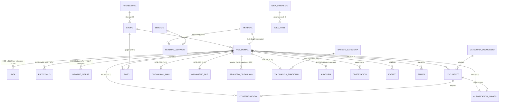

# Esquema de datos v2 — HCE IPPU (M11 · backend v2)

> **Estado: PROPUESTA PARA REVISIÓN (2026-07-30).** No implementada todavía.
> Deriva del **Documento Técnico IPPU v1.0** (§6 modelo sugerido) y del **modelo clínico ya
> validado en la demo v4.0** (ronda M0–M10). Toma `docs/markdown/modelo-datos.md` como punto de
> partida **con los bugs A y B corregidos** y las 3 decisiones de arquitectura cerradas (2026-07-30).
> Reemplaza a `esquema-datos.md` (v1, pre-Documento Técnico) cuando se implemente.

## 0. Decisiones de arquitectura aplicadas (cierran el Anexo A del plan)

| # | Decisión | Consecuencia en este esquema |
|---|---|---|
| 1 | **Postgres-only** (dev y prod vía docker-compose; se abandona SQLite en dev) | Se usa `JSONB` para el contenido de instrumentos y `CHECK`s reales. Una sola migración inicial limpia (el esquema v1 nunca tuvo datos reales). |
| 2 | **Lógica de negocio en el servidor** (Pydantic + servicios FastAPI), **sin triggers PL/pgSQL** | La BD guarda **integridad estructural** (FK, UNIQUE, CHECK de rango, XOR). Todas las reglas clínicas viven en Python, testeables con pytest (ver §4). |
| 3 | **Portabilidad = paramétrico mínimo** | Sólo catálogos que el Doc. Técnico exige como dato: `baremo_categoria` (§0.4), roles como texto (`tecnicoN_rol`), `recordatorio`, `categoria_documento`. **No** se construyen `config_institucion` ni `vocabulario`. |

**Bugs de `modelo-datos.md` corregidos:**
- **A.** `informe_cierre` era `||--o|` (a lo sumo uno en la vida del NNA) → pasa a **1:N** con `UNIQUE(hce_id, anio)`: es un informe **anual**, uno por ciclo, igual que `protocolo`.
- **B.** `PERSONA ||--|| HCE_DIURNA` (1:1 obligatorio) → pasa a **0..1** (`persona` puede existir sin HCE de Atención Diurna) + `persona_servicio` N:M para la identidad única transversal a servicios (§3.1). Taller Terapéutico y Clínica quedan reservados (Fase 2) sin forzar el modelo.

**Regla de reparto (heredada de `modelo-datos.md`, que estaba bien):** identidad y relaciones en
columnas relacionales; el contenido de cada instrumento (12 dimensiones, 24 ítems, firmas,
addendas, excepciones) en JSONB; los totales derivados se **materializan en columnas** — pero los
calcula y valida **el servidor** al guardar/firmar, no un trigger.

## 1. Diagrama ER (núcleo)

## 2. Tablas

### 2.1 Identidad y organización
| Tabla | Campos clave | Notas |
|---|---|---|
| `profesional` | id, nombre, especialidad, email **UK**, rol (`admin\|tecnico`), hashed_password (Fase 4), activo | ex-`terapeuta` de v1; también evaluador/firmante. |
| `persona` | id, nombre, apellido, ci **UK**, fecha_nac, sexo, localidad, referente, telefono | Identidad única transversal (§3.1). La edad se calcula. |
| `servicio` | id, clave (`atencion_diurna\|taller_terapeutico\|clinica`), activo | Los dos últimos reservados para Fase 2 (§0.3). |
| `persona_servicio` | persona_id FK, servicio_id FK, fecha_alta, fecha_baja | **UK**(persona, servicio). |
| `grupo` | id (`A..E`), franja, dias, horario, anio, tecnico1_id FK, **tecnico1_rol** (texto), tecnico2_id FK, **tecnico2_rol**, obs | Roles = etiqueta configurable como dato (decisión 3 / §0.5). ⚠️ **Ver la nota de abajo: la PK por letra no admite más de un año.** |

> ⚠️ **Limitación conocida de `grupo` (detectada 2026-08-07 al implementar M11.2, sin resolver).**
> La PK es sólo la letra, pero la tabla lleva `anio`: **el grupo A puede existir para un único año en
> toda la historia**. En 2027, crear el grupo A obliga a sobrescribir la fila de 2026 — se pierde el
> registro de quiénes fueron sus técnicos ese año, y los expedientes viejos (`hce_diurna.grupo_id`,
> que guarda sólo la letra) pasan a apuntar al grupo del año nuevo **sin aviso**. Contradice cómo este
> mismo documento resuelve los ciclos anuales en `protocolo` e `informe_cierre`, que usan
> `(hce_id, …, anio)` justamente para esto.
>
> **Se implementó tal cual está especificado acá**, sin corregirlo por cuenta propia: cambiarlo
> modifica este documento y eso se decide por escrito. Opciones sobre la mesa: (a) PK compuesta
> `(id, anio)` · (b) id propio con `UNIQUE(letra, anio)` · (c) dejarlo así porque los grupos no se
> reconfiguran año a año — en cuyo caso **sobra la columna `anio`**. Anotado en
> `docs/notas/puntos-a-validar.md` §2.6. No bloquea M11.3.
| `hce_diurna` | id, persona_id FK **UK** (0..1), **hc_historico** (identificador secundario, §10), grupo_id FK, diagnostico, cie11, nivel_soporte, dx_fecha, derivacion, medicacion, alerta, **anamnesis JSONB**, activo, fecha_baja, timestamps | HCE-00 siempre editable (sin firma). Un expediente por persona; los ciclos anuales viven en `protocolo.anio` / `informe_cierre.anio` (decisión abierta de `modelo-datos.md`, resuelta así). |
| `hce_taller` | hce_id FK, taller_id FK | Plan IPPU (N:M). |

### 2.2 Módulos del flujo (CI → LB → PA → PB → IC)
Mixin común de firma (columnas en cada tabla de módulo): `firmado bool`, `firmas JSONB`
(lista `{profesional_id, rol, fecha}` — doble para LB/PA/PB/IC, familia para CI), `addendas JSONB`,
`excepcion JSONB` (`{motivo, texto, profesional_id, fecha}`). El **estado visible**
(`bloqueado|borrador|firmado`) **no se almacena**: lo deriva el servidor (mismo diseño sin drift
que la demo, M1).

| Tabla | Campos propios | Notas |
|---|---|---|
| `consentimiento` | **PK = hce_id**, firmante, fecha, **autorizaciones JSONB** (`{evaluacion, registro, comunicacion}`), documento_id FK (adjunto) | Único bloqueo sin excepción (§4.2): lo impone el servidor. |
| `idea` (HCE-LB) | id, hce_id FK, **dim JSONB** (12 × `{valor 0–8\|"NS", obs}`), fecha_consenso, sesiones, sintesis, objetivos, **migrado_origen JSONB**, `total`, `esc_a..esc_d` (materializados) | 1:N — reingreso >12 meses = instancia nueva; la vigente es la de mayor `fecha_consenso`. `CHECK(total BETWEEN 0 AND 96)`. |
| `protocolo` (HCE-PA/PB) | id, hce_id FK, **tipo CHECK ('A','B')**, **anio**, fecha, semanas, **items JSONB** (24 × `{valor 1–5, obs}`), sint_tec1, sint_tec2, otros, ajustes (sólo B), **deltas JSONB** (sólo B; escribe el servidor al firmar B), `total`, `esc_1..esc_4` | **UK**(hce_id, tipo, anio). `CHECK(total BETWEEN 24 AND 120)`. `CHECK(tipo='B' OR deltas IS NULL)`. |
| `informe_cierre` (HCE-IC) | id, hce_id FK, **anio**, fecha, **sint_escala JSONB** (4), val_tec1, val_tec2, recomendaciones, orientaciones, **recibi JSONB** (`{firmante, fecha}`) | **UK**(hce_id, anio) — bug A corregido. El PDF se genera desde acá: único informe válido (§5.3). |

### 2.3 Transversales (DOC · ORG · VF · LOG)
| Tabla | Campos clave | Notas |
|---|---|---|
| `documento` | id, hce_id FK, categoria_id FK, nombre, fecha_original, fecha_carga, **es_registro_historico bool**, archivo_ref (storage real: Fase 6) | Histórico (§10) = inmutable: el servidor rechaza UPDATE/DELETE. |
| `autorizacion_imagen` | **PK = hce_id**, registrada bool, fecha, documento_id FK (copia firmada) | Condición §8.4 para `foto`. |
| `foto` | id, **hce_id nullable / grupo_id nullable + `CHECK(num_nonnulls(hce_id, grupo_id)=1)`**, descripcion, fecha, archivo_ref | Individual: exige autorización del NNA; grupal: de **todas** las familias activas del grupo — ambas en el servidor (§4). |
| `organismo_inau` | **PK = hce_id**, sipi, convenio, referente, ingreso, obs | |
| `organismo_bps` | **PK = hce_id**, prestacion, tramite, estado, vencimiento, obs | Alertas AYEX 60/30: servidor/panel. |
| `registro_organismo` | id, hce_id FK, **organismo CHECK ('inau','bps')**, fecha, detalle, autor_id FK | Envíos INAU y gestiones BPS (tabla hija consultable — mejor que JSONB para el panel institucional). |
| `valoracion_funcional` | **PK = hce_id**, estado, fecha, organismo, **pct NUMERIC CHECK (0–100)**, **categoria_id FK** `baremo_categoria`, vigencia, rnpcd, **dominios JSONB** (6), capacidades, barreras, apoyos, obs, sintesis_funcional | `categoria_id` la escribe el servidor **sólo** desde `pct` (§7.5). Alerta 90/30 (§7.8): servidor. |
| `auditoria` (HCE-LOG) | id, hce_id FK, ts, usuario_id FK, **modulo**, **tipo CHECK** (`edicion\|firma\|excepcion\|addenda\|alerta\|carga\|acceso`), detalle | **Solo inserción**: sin endpoints de UPDATE/DELETE; refuerzo recomendado sin triggers: `REVOKE UPDATE, DELETE ON auditoria FROM rol_app` (permiso, no lógica). |
| `observacion` | id, hce_id FK, fecha, autor_id FK, texto | Igual que v1 (pestaña de seguimiento). |
| `evento` | id, hce_id FK, tipo (`alta\|baja`), fecha, titulo, descripcion, autor_id FK | Igual que v1 (línea de tiempo). |

### 2.4 Catálogos paramétricos (decisión 3: mínimos)
| Tabla | Contenido | Por qué es dato |
|---|---|---|
| `idea_dimension` + `idea_nivel` | 12 dimensiones (4 escalas) con descriptores oficiales 0–8 | Ya existía en v1; el editor los muestra. |
| `ippu_item` | 24 ítems (escala 1–4, texto, referencia documental **no verificada**) | Instrumento propio; IPPU puede ajustar redacción. |
| `baremo_categoria` | 5 filas (min, max, categoria, rango, implicancia) | **§0.4**: cortes a confirmar contra el anexo del Decreto 72/025 — editable sin migración. |
| `categoria_documento` | 12 categorías (incl. las 4 de «Registro histórico — HCE anterior») | §10. |
| `recordatorio` | 4 filas (clave, texto, periodo, activo) | §4: configurables por coordinación, nunca bloqueantes. |
| `taller` · `servicio` | 18 talleres · 3 servicios | Ya existía / §3.1. |

## 3. Qué cambia respecto del esquema v1 (Fases 0–2)

| v1 (pre-Doc. Técnico) | v2 |
|---|---|
| `terapeuta` | `profesional` (rename + campos igual) |
| `nna` (todo junto) | `persona` + `hce_diurna` + `persona_servicio` (identidad ≠ expediente) |
| `evaluacion_idea` **anual** + `dimension_idea` (filas) | `idea` **línea base única** con `dim JSONB` (el detalle por fila ya no paga su costo: el instrumento se lee/escribe entero) |
| `evaluacion_likert` + `item_likert` (intermedia 3×12) | **Se elimina** → `protocolo` A/B (Escala IPPU-TEA, 24 ítems JSONB) |
| `evaluacion_area/general` + ítems (provisionales) | **Se eliminan** → `documento` con `es_registro_historico` (§10, como en la demo M7) |
| `anamnesis` (tabla 1:1) | `hce_diurna.anamnesis` JSONB (HCE-00) |
| — | Nuevos: `consentimiento`, `informe_cierre`, `documento`, `foto`, `autorizacion_imagen`, `organismo_*`, `registro_organismo`, `valoracion_funcional`, `auditoria`, `baremo_categoria`, `categoria_documento`, `recordatorio`, `servicio`, `persona_servicio` |
| `observacion`, `evento`, `grupo`, `taller`, catálogo IDEA | Se conservan (ajustes menores: FK a `hce_diurna`) |
| Migraciones incrementales SQLite-compatibles | **Migración inicial única** contra Postgres (v1 sin datos reales; los 12 tests v1 se reescriben como tests v2 — el plan §M11.4 ya preveía tests nuevos al mover lógica) |

## 4. Reglas duras — todas en el servidor (decisión 2)

| Regla (fuente) | Dónde vive en v2 | Test previsto |
|---|---|---|
| Secuencia CI→LB→PA→PB→IC; CI **no exceptuable** (§4.2) | Servicio `flujo.py`: `modulo_habilitado()` / `estado_modulo()` (derivado, sin drift) | firmar PA sin LB → 409; excepción con constancia → OK + auditoría; nada sin CI |
| Firma = bloqueo; corrección por addenda (§4.1) | Servicio: `firmar_modulo()` (transacción: firma + totales + auditoría); PUT sobre módulo firmado → 409; endpoint `/addendas` | editar firmado → 409; addenda queda en JSONB + LOG |
| Validaciones de integridad §4.3 por módulo | Schemas Pydantic + servicio (12 dim sin NS, obs obligatoria en ítems 1/5, síntesis, fechas…) | firma incompleta → 422 con detalle |
| **Δ sólo B−A, jamás entre instrumentos** (§5.2) | `calcular_delta(protocolo_a, protocolo_b)` tipado: sólo acepta dos `Protocolo`; el servidor lo ejecuta al firmar B | pasar `Idea` → TypeError/422; delta correcto al firmar B; alerta Δ≤−7 → auditoría |
| **Categoría del baremo sólo desde `pct` oficial** (§7.5) | `categoria_baremo(pct)` en servicio VF; ningún camino recibe instrumentos clínicos | intentar derivar desde puntajes → error; pct 58 → Severo |
| Protección de imagen individual/grupal (§8.4) | Servicio `foto.py`: exige `autorizacion_imagen` del NNA / de todas las familias activas del grupo | carga sin autorización → 403 con detalle de quiénes faltan |
| Registro histórico inmutable (§10) | Servicio `documento.py`: UPDATE/DELETE sobre `es_registro_historico` → 403 | |
| Auditoría solo-inserción (§3.2/§9) | Sin endpoints de mutación + `REVOKE` de permisos (opcional, no es trigger) | |
| Informe único (§5.3) | El PDF/render del IC sale sólo de `informe_cierre` firmado | |
| Terminología §8.1 | Constante en `core/` compartida por schemas y textos | |

## 5. Plan de implementación (sub-módulos de M11)

1. **M11.1 — Infra Postgres-only:** `docker-compose.yml` (Postgres 16 + volumen), `.env`/config,
   `database.py` a psycopg, README de arranque. Alembic re-inicializado (migración inicial única v2).
2. **M11.2 — Modelos + migración + catálogos:** SQLAlchemy v2 de §2, seed de catálogos
   (IDEA/IPPU-TEA/baremo/categorías/recordatorios/talleres/servicios).
3. **M11.3 — Servicios (motor de flujo):** `flujo.py` (habilitado/estado/firmar/addenda/excepción
   + auditoría transaccional), guards §5.2/§7.5, totales materializados.
4. **M11.4 — Routers v2:** persona/HCE (búsqueda 3 vías), módulos CI/LB/PA/PB/IC, DOC/foto,
   ORG, VF (+ autogeneración descriptiva), auditoría (GET), Swagger con ejemplos.
5. **M11.5 — Seed clínico + tests:** seed espejo de la demo v4.0 (8 NNA, 4 arquetipos §11) y
   pytest contra Postgres. **Criterio de aceptación (§12-A):** reproducir por API el ciclo del
   usuario demo 1 con números idénticos (IDEA 58 · PA 60 · PB 79 · Δ +19) + guards + secuencia.
6. **M11.6 — Cierre:** actualizar este doc al estado "implementado", `ejemplos-endpoints.md` v2,
   handoff. Después (rondas siguientes): **Fase 3** conectar la demo a la API → **Fase 4** JWT/roles (§9) → **Fase 6** resto de Docker (app + NGINX).

## 6. Preguntas abiertas (no bloquean el arranque)
- **Cortes del baremo**: confirmar con IPPU contra el anexo del Decreto 72/025 (ya parametrizado).
- **Kappa interjueces (§9)**: `firmas JSONB` ya admite puntuaciones por evaluador; el cálculo queda
  para fase piloto (§12-D), fuera de M11.
- **Validación de la demo v4.0 con IPPU** (puerta formal de M11): si IPPU pide cambios en la línea
  base única, se ajusta `idea` antes de M11.2.
