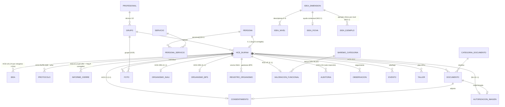

# Esquema de datos v2 — HCE IPPU (M11 · backend v2)

> **Estado: IMPLEMENTADO en M11.2** (2026-08-07, 28 tablas + migración inicial única) y **en curso de
> ampliación por la ronda M12** (absorción del Prototipo v4). Lo marcado «M12.1» ya está en los modelos;
> **la migración se regenera una sola vez en M12.8** (regla de la ronda), así que hasta entonces los
> modelos van deliberadamente adelante del esquema aplicado. Este documento pasa a **v3** en M12.8.
>
> Deriva del **Documento Técnico IPPU v1.0** (§6 modelo sugerido) y del **modelo clínico ya
> validado en la demo v4.0** (ronda M0–M10). Toma `docs/markdown/modelo-datos.md` como punto de
> partida **con los bugs A y B corregidos** y las 3 decisiones de arquitectura cerradas (2026-07-30).
> Reemplaza a `esquema-datos.md` (v1, pre-Documento Técnico).
>
> **Fuente normativa desde ago-2026 (§5.10 / D1):** Manual de Procedimientos v1.0 + Prototipo v4 de
> IPPU, por encima del Documento Técnico. Decisiones de la ronda: `handoff.md` §5.10–§5.18.

## 0. Decisiones de arquitectura aplicadas (cierran el Anexo A del plan)

| # | Decisión | Consecuencia en este esquema |
|---|---|---|
| 1 | **Postgres-only** (dev y prod vía docker-compose; se abandona SQLite en dev) | Se usa `JSONB` para el contenido de instrumentos y `CHECK`s reales. Una sola migración inicial limpia (el esquema v1 nunca tuvo datos reales). |
| 2 | **Lógica de negocio en el servidor** (Pydantic + servicios FastAPI), **sin triggers PL/pgSQL** | La BD guarda **integridad estructural** (FK, UNIQUE, CHECK de rango, XOR). Todas las reglas clínicas viven en Python, testeables con pytest (ver §4). |
| 3 | **Portabilidad = paramétrico mínimo** | Sólo catálogos que el Doc. Técnico exige como dato: `baremo_categoria` (§0.4), roles como texto (`tecnicoN_rol`), `recordatorio`, `categoria_documento`. **No** se construyen `config_institucion` ni `vocabulario`. |

**Bugs de `modelo-datos.md` corregidos:**
- **A.** `informe_cierre` era `||--o|` (a lo sumo uno en la vida del NNA) → pasa a **1:N** con `UNIQUE(hce_id, anio)`: es un informe **anual**, uno por ciclo, igual que `protocolo`.
- **B.** `PERSONA ||--|| HCE_DIURNA` (1:1 obligatorio) → pasa a **0..1** (`persona` puede existir sin HCE de Atención Diurna) + `persona_servicio` N:M para la identidad única transversal a servicios (§3.1). Taller Terapéutico y Clínica quedan reservados (Fase 2) sin forzar el modelo.

**Regla de reparto (heredada de `modelo-datos.md`, que estaba bien):** identidad y relaciones en
columnas relacionales; el contenido de cada instrumento (12 dimensiones, 24 ítems, firmas,
addendas, excepciones) en JSONB; los totales derivados se **materializan en columnas** — pero los
calcula y valida **el servidor** al guardar/firmar, no un trigger.

## 1. Diagrama ER (núcleo)

## 2. Tablas

### 2.1 Identidad y organización
| Tabla | Campos clave | Notas |
|---|---|---|
| `profesional` | id, nombre, especialidad, email **UK**, rol (`admin\|tecnico`), hashed_password (Fase 4), activo | ex-`terapeuta` de v1; también evaluador/firmante. |
| `persona` | id, nombre, apellido, ci **UK**, fecha_nac, sexo, localidad, referente, telefono, **+ metadatos de origen** | Identidad única transversal (§3.1). La edad se calcula. |
| `servicio` | id, clave (`atencion_diurna\|taller_terapeutico\|clinica`), activo | Los dos últimos reservados para Fase 2 (§0.3). |
| `persona_servicio` | persona_id FK, servicio_id FK, fecha_alta, fecha_baja | **UK**(persona, servicio). |
| `grupo` | **id serial** (identificador sin significado), **nombre** (`Grupo Azul\|Celeste\|Naranja\|Verde`), **anio SMALLINT**, **UK(nombre, anio)**, franja, dias, horario, tecnico1_id FK, **tecnico1_rol** (texto), tecnico2_id FK, **tecnico2_rol**, obs | **D9 (§5.18), confirmada 2026-08-14.** Un grupo por color **y por año**: «Azul 2026» y «Azul 2027» son dos filas. Roles = etiqueta configurable como dato (decisión 3 / §0.5). Ver la nota de abajo. |

> **`grupo` — por qué el id es propio y la unicidad es `(nombre, anio)`** (D9, `handoff.md` §5.18;
> confirmada por el equipo el 2026-08-14, implementada en M12.1).
>
> Hasta M11.2 la PK era la letra (`A..E`), así que **un grupo existía una sola vez en toda la historia**:
> en 2027, crear el Grupo Azul obligaba a sobrescribir la fila de 2026 —se perdía quiénes fueron sus
> técnicos ese año— y los expedientes de 2026 (`hce_diurna.grupo_id`) pasaban a apuntar silenciosamente
> al grupo del año nuevo. Con **id propio sin significado**, «Azul 2026» y «Azul 2027» son dos filas
> distintas y el vínculo de cada expediente no se mueve nunca. El `UNIQUE(nombre, anio)` impide el
> problema opuesto: dos filas «Azul 2026» por error.
>
> **Granularidad anual, no por fecha.** Con fecha completa, «Azul 2026-03-01» y «Azul 2026-08-15» serían
> dos filas válidas y volvería a haber dos grupos Azul en el mismo año. Además `anio` es la granularidad
> que este mismo documento ya usa en `protocolo` e `informe_cierre` para los ciclos anuales.
>
> **Los nombres por color van en la fila, sin catálogo aparte.** Los grupos de IPPU son Azul · Celeste ·
> Naranja · Verde (Prototipo v4); `A..E` era invención nuestra. Si en 2028 dejan de usar «Naranja», la
> fila de 2026 lo sigue diciendo, y un catálogo de colores sólo sería una tabla más que mantener.
>
> ⚠️ **Límite aceptado:** con granularidad anual, un **cambio de técnico a mitad de año** sobrescribe la
> fila y sólo queda rastro en `auditoria`. Modelar vigencias por técnico es bastante más caro y depende
> de las respuestas de IPPU a §3.7/§3.8 de `docs/notas/consulta-a-ippu.md`. Si responden que pasa
> seguido, se revisa.
| `hce_diurna` | id, persona_id FK **UK** (0..1), **hc_historico** (identificador secundario, §10), **grupo_id FK (entero)**, diagnostico, cie11, nivel_soporte, dx_fecha, derivacion, medicacion, alerta, **anamnesis JSONB**, activo, fecha_baja, timestamps, **+ metadatos de origen** | HCE-00 siempre editable (sin firma). Un expediente por persona; los ciclos anuales viven en `protocolo.anio` / `informe_cierre.anio` (decisión abierta de `modelo-datos.md`, resuelta así). |
| `hce_taller` | hce_id FK, taller_id FK | Plan IPPU (N:M). |

> **Metadatos de origen (`OrigenMigracionMixin`, M12.1 · §10).** Cuatro columnas nullable en `persona`,
> `hce_diurna` e `idea`: **`sistema_origen`** (NULL = el dato nació acá), **`fecha_original`** (la que
> tenía en el sistema viejo), **`fecha_migracion`** y **`responsable_migracion`** (texto, no FK: quien
> firma el acta puede no ser usuario del sistema). Reemplazan al `idea.migrado_origen JSONB` de M11.2,
> que era la misma información en una bolsa sin forma —imposible de filtrar y sin garantía de que dos
> cargas usaran las mismas claves. La estrategia de migración de IPPU (sólo el IDEA estructurado, el
> resto legacy, acta de cierre, verificación por muestreo) no funciona si después no se puede distinguir
> lo migrado de lo cargado acá.

### 2.2 Módulos del flujo (CI → LB → PA → PB → IC)
Mixin común de firma (columnas en cada tabla de módulo): `firmado bool`, `firmas JSONB`
(lista `{profesional_id, rol, fecha}` — doble para LB/PA/PB/IC, familia para CI), `addendas JSONB`,
`excepcion JSONB` (`{motivo, texto, profesional_id, fecha}`). El **estado visible**
(`bloqueado|borrador|firmado`) **no se almacena**: lo deriva el servidor (mismo diseño sin drift
que la demo, M1).

| Tabla | Campos propios | Notas |
|---|---|---|
| `consentimiento` | **PK = hce_id**, firmante, fecha, **autorizaciones JSONB** (`{evaluacion, registro, comunicacion}`), documento_id FK (adjunto) | Único bloqueo sin excepción (§4.2): lo impone el servidor. |
| `idea` (HCE-LB) | id, hce_id FK, **dim JSONB** (12 × `{valor 0–8\|"NS", obs}`), fecha_consenso, sesiones, sintesis, objetivos, **manual_version**, **+ metadatos de origen**, `total`, `esc_a..esc_d` (materializados) | 1:N — reingreso >12 meses = instancia nueva; la vigente es la de mayor `fecha_consenso`. `CHECK(total BETWEEN 0 AND 96)`. **`manual_version`** (M12.1) persiste con qué manual se aplicó la evaluación (`core/constantes.py::IDEA_MANUAL_VERSION`); sin eso, corregir un descriptor reescribiría el criterio de todo lo ya firmado. |
| `protocolo` (HCE-PA/PB) | id, hce_id FK, **tipo CHECK ('A','B')**, **anio**, fecha, semanas, **items JSONB** (24 × `{valor 1–5, obs}`), sint_tec1, sint_tec2, otros, ajustes (sólo B), **deltas JSONB** (sólo B; escribe el servidor al firmar B), `total`, `esc_1..esc_4` | **UK**(hce_id, tipo, anio). `CHECK(total BETWEEN 24 AND 120)`. `CHECK(tipo='B' OR deltas IS NULL)`. |
| `informe_cierre` (HCE-IC) | id, hce_id FK, **anio**, fecha, **sint_escala JSONB** (4), val_tec1, val_tec2, recomendaciones, orientaciones, **recibi JSONB** (`{firmante, fecha}`) | **UK**(hce_id, anio) — bug A corregido. El PDF se genera desde acá: único informe válido (§5.3). |

### 2.3 Transversales (DOC · ORG · VF · LOG)
| Tabla | Campos clave | Notas |
|---|---|---|
| `documento` | id, hce_id FK, categoria_id FK, nombre, fecha_original, fecha_carga, **es_registro_historico bool**, archivo_ref (storage real: Fase 6) | Histórico (§10) = inmutable: el servidor rechaza UPDATE/DELETE. |
| `autorizacion_imagen` | **PK = hce_id**, registrada bool, fecha, documento_id FK (copia firmada) | Condición §8.4 para `foto`. |
| `foto` | id, **hce_id nullable / grupo_id nullable + `CHECK(num_nonnulls(hce_id, grupo_id)=1)`**, descripcion, fecha, archivo_ref | Individual: exige autorización del NNA; grupal: de **todas** las familias activas del grupo — ambas en el servidor (§4). |
| `organismo_inau` | **PK = hce_id**, sipi, convenio, referente, ingreso, obs | |
| `organismo_bps` | **PK = hce_id**, prestacion, tramite, estado, vencimiento, obs | Alertas AYEX 60/30: servidor/panel. |
| `registro_organismo` | id, hce_id FK, **organismo CHECK ('inau','bps')**, fecha, detalle, autor_id FK | Envíos INAU y gestiones BPS (tabla hija consultable — mejor que JSONB para el panel institucional). |
| `valoracion_funcional` | **PK = hce_id**, estado, fecha, organismo, **pct NUMERIC CHECK (0–100)**, **categoria_id FK** `baremo_categoria`, vigencia, rnpcd, **dominios JSONB** (6), capacidades, barreras, apoyos, obs, sintesis_funcional | `categoria_id` la escribe el servidor **sólo** desde `pct` (§7.5). Alerta 90/30 (§7.8): servidor. |
| `auditoria` (HCE-LOG) | id, **hce_id FK nullable**, ts, usuario_id FK, **modulo**, **tipo CHECK** (`edicion\|firma\|excepcion\|addenda\|alerta\|carga\|acceso`), **campo**, **valor_ant**, **valor_nuevo**, detalle | **Solo inserción**: sin endpoints de UPDATE/DELETE; refuerzo recomendado sin triggers: `REVOKE UPDATE, DELETE ON auditoria FROM rol_app` (permiso, no lógica). **M12.1 — granularidad de campo:** antes alcanzaba para «alguien editó HCE-LB», no para «qué cambió y de qué a qué». Importa para D9: con granularidad anual del grupo, un cambio de técnico a mitad de año sobrescribe la fila y **el único rastro del valor anterior es esta tabla**. `hce_id` pasa a nullable porque hay eventos institucionales (cambiar los técnicos de un grupo, retirar un taller) que no son de ningún expediente. |
| `observacion` | id, hce_id FK, fecha, autor_id FK, texto | Igual que v1 (pestaña de seguimiento). |
| `evento` | id, hce_id FK, tipo (`alta\|baja`), fecha, titulo, descripcion, autor_id FK | Igual que v1 (línea de tiempo). |

### 2.4 Catálogos paramétricos (decisión 3, **ampliada por D6 / §5.15**)
| Tabla | Contenido | Por qué es dato |
|---|---|---|
| `idea_dimension` + `idea_nivel` | 12 dimensiones (4 escalas, + **`que_evalua`**) con descriptores oficiales 0–8 + **`descriptor_breve`** | Ya existía en v1; el editor los muestra. Ver la nota de abajo sobre los 60 descriptores. |
| `ippu_item` | 24 ítems (escala 1–4, texto, referencia documental **no verificada**) | Instrumento propio; IPPU puede ajustar redacción. |
| `baremo_categoria` | 5 filas (min, max, categoria, rango, implicancia) | **§0.4**: cortes a confirmar contra el anexo del Decreto 72/025 — editable sin migración. |
| `categoria_documento` | 12 categorías (incl. las 4 de «Registro histórico — HCE anterior») | §10. |
| `recordatorio` | **8 filas** (clave, texto, periodo, activo, orden) — flujo (`lb pa pb ic`) + vencimientos (`ayex vf inc inau`) | §4: configurables por coordinación, **nunca bloqueantes**. |
| `taller` · `servicio` | talleres (los 14 reales entran en **M12.3** · D5) · 3 servicios | Ya existía / §3.1. |
| **`banda_idea`** (M12.1 · D4) | **6 tramos** del total 0–96 con `perfil`, `nivel_dsm` (DSM-5-TR) y `texto` orientativo | Deroga las 3 bandas de `handoff.md` §3. Los cortes son de la institución (`solo_al_crear`); el **texto se copia tal cual** del prototipo porque es deliberadamente neutro —alude sólo a escalas y dimensiones del IDEA y no prescribe abordajes— y reescribirlo rompe esa propiedad. |
| **`delta_interpretacion`** (M12.1) | **6 tramos** del Δ (B−A) con `etiqueta`, `accion`, `signo` y **`alerta`**; extremos abiertos (límites nullable) | **La alerta institucional Δ ≤ −7 pasa a derivarse de acá**, no de un número suelto en el código. Sigue valiendo §5.2: el Δ es siempre B−A entre dos protocolos. |
| **`idea_ficha`** (M12.1) | 12 fichas (`IDEA-D01..D12`): definición, objetivo, indicadores, qué no confundir, errores frecuentes, preguntas guía, claves de J. Martos, nota de evidencia | Ayuda contextual, nivel 1 de 3. |
| **`idea_ejemplo`** (M12.1) | 48 filas: 12 dimensiones × niveles **8, 6, 4, 2** | Nivel 2 de 3. No hay ejemplo de nivel 0 y no se inventa: 0 es «sin trastorno cualitativo». |
| **`idea_regla`** (M12.1) | 9 reglas de aplicación con su fuente | Nivel 3 de 3. Panel IDEA-REGLAS. |

> **Los 60 descriptores NO se reemplazaron por los del Prototipo v4** (decisión de M12.1). El diff de
> M12.0 mostró que 59 de 60 difieren textualmente pero **ninguno por corrimiento de niveles**: los
> nuestros son el texto literal de la fuente oficial (Rivière, 1997/2002) y los del prototipo son
> paráfrasis condensadas de los mismos niveles. El corrimiento que el prototipo declara haber corregido
> es contra una «Guía del aplicador» interna de IPPU que nunca tuvimos y de la que los nuestros no
> derivan. La versión corta entra **al lado**, como `idea_nivel.descriptor_breve`, para las pantallas
> donde el texto oficial no entra — **nunca encima**.

> **Lo que NO es catálogo** vive en `app/core/constantes.py`: etiquetas Likert, dominios y niveles de
> HCE-VF, guía de prestaciones, opciones de BPS y vocabulario institucional. **Criterio:** tabla si se
> consulta, se filtra, se ordena o **la institución lo cambia sin desplegar**; constante si es texto fijo
> de presentación que acompaña a un valor ya guardado. Los 6 dominios de VF, por ejemplo, son las claves
> fijas de `valoracion_funcional.dominios` (JSONB) y vienen de la CIF, no de IPPU: agregar un séptimo no
> es un `UPDATE` sino un cambio de formulario.

## 3. Qué cambia respecto del esquema v1 (Fases 0–2)

| v1 (pre-Doc. Técnico) | v2 |
|---|---|
| `terapeuta` | `profesional` (rename + campos igual) |
| `nna` (todo junto) | `persona` + `hce_diurna` + `persona_servicio` (identidad ≠ expediente) |
| `evaluacion_idea` **anual** + `dimension_idea` (filas) | `idea` **línea base única** con `dim JSONB` (el detalle por fila ya no paga su costo: el instrumento se lee/escribe entero) |
| `evaluacion_likert` + `item_likert` (intermedia 3×12) | **Se elimina** → `protocolo` A/B (Escala IPPU-TEA, 24 ítems JSONB) |
| `evaluacion_area/general` + ítems (provisionales) | **Se eliminan** → `documento` con `es_registro_historico` (§10, como en la demo M7) |
| `anamnesis` (tabla 1:1) | `hce_diurna.anamnesis` JSONB (HCE-00) |
| — | Nuevos: `consentimiento`, `informe_cierre`, `documento`, `foto`, `autorizacion_imagen`, `organismo_*`, `registro_organismo`, `valoracion_funcional`, `auditoria`, `baremo_categoria`, `categoria_documento`, `recordatorio`, `servicio`, `persona_servicio` |
| `observacion`, `evento`, `grupo`, `taller`, catálogo IDEA | Se conservan (ajustes menores: FK a `hce_diurna`) |
| Migraciones incrementales SQLite-compatibles | **Migración inicial única** contra Postgres (v1 sin datos reales; los 12 tests v1 se reescriben como tests v2 — el plan §M11.4 ya preveía tests nuevos al mover lógica) |

## 4. Reglas duras — todas en el servidor (decisión 2)

| Regla (fuente) | Dónde vive en v2 | Test previsto |
|---|---|---|
| Secuencia CI→LB→PA→PB→IC; CI **no exceptuable** (§4.2) | Servicio `flujo.py`: `modulo_habilitado()` / `estado_modulo()` (derivado, sin drift) | firmar PA sin LB → 409; excepción con constancia → OK + auditoría; nada sin CI |
| Firma = bloqueo; corrección por addenda (§4.1) | Servicio: `firmar_modulo()` (transacción: firma + totales + auditoría); PUT sobre módulo firmado → 409; endpoint `/addendas` | editar firmado → 409; addenda queda en JSONB + LOG |
| Validaciones de integridad §4.3 por módulo | Schemas Pydantic + servicio (12 dim sin NS, obs obligatoria en ítems 1/5, síntesis, fechas…) | firma incompleta → 422 con detalle |
| **Δ sólo B−A, jamás entre instrumentos** (§5.2) | `calcular_delta(protocolo_a, protocolo_b)` tipado: sólo acepta dos `Protocolo`; el servidor lo ejecuta al firmar B | pasar `Idea` → TypeError/422; delta correcto al firmar B; alerta Δ≤−7 → auditoría |
| **Categoría del baremo sólo desde `pct` oficial** (§7.5) | `categoria_baremo(pct)` en servicio VF; ningún camino recibe instrumentos clínicos | intentar derivar desde puntajes → error; pct 58 → Severo |
| Protección de imagen individual/grupal (§8.4) | Servicio `foto.py`: exige `autorizacion_imagen` del NNA / de todas las familias activas del grupo | carga sin autorización → 403 con detalle de quiénes faltan |
| Registro histórico inmutable (§10) | Servicio `documento.py`: UPDATE/DELETE sobre `es_registro_historico` → 403 | |
| Auditoría solo-inserción (§3.2/§9) | Sin endpoints de mutación + `REVOKE` de permisos (opcional, no es trigger) | |
| Informe único (§5.3) | El PDF/render del IC sale sólo de `informe_cierre` firmado | |
| Terminología §8.1 | `core/constantes.py::VOCABULARIO_PROHIBIDO`, compartida por schemas y textos generados | catálogo sin «grave» (ya en `test_m12_catalogos.py`); pendiente: los textos que genera el servidor |
| **IDEA firmado atado a `manual_version`** (M12.1) | El servicio de firma escribe `IDEA_MANUAL_VERSION`; nunca se recalcula sobre una evaluación vieja | firmar → queda la versión; reabrir un IDEA de otra versión no la pisa |
| **Banda del IDEA sólo desde `banda_idea`** (D4) | Servicio: `banda(total)` lee el catálogo; ningún corte hardcodeado | mover un corte por UPDATE cambia la banda devuelta |
| **Alerta del Δ sólo desde `delta_interpretacion`** (M12.1) | La alerta institucional sale de la fila con `alerta=True`, no del literal −7 | Δ = −7 → alerta; Δ = −6 → no |
| **Auditoría de campo** (M12.1) | Toda edición registra `campo`, `valor_ant`, `valor_nuevo`; los cambios de grupo y de catálogo van con `hce_id NULL` | cambiar el técnico de un grupo deja el valor anterior legible |

## 5. Plan de implementación (sub-módulos de M11)

1. **M11.1 — Infra Postgres-only:** `docker-compose.yml` (Postgres 16 + volumen), `.env`/config,
   `database.py` a psycopg, README de arranque. Alembic re-inicializado (migración inicial única v2).
2. **M11.2 — Modelos + migración + catálogos:** SQLAlchemy v2 de §2, seed de catálogos
   (IDEA/IPPU-TEA/baremo/categorías/recordatorios/talleres/servicios).
3. **M11.3 — Servicios (motor de flujo):** `flujo.py` (habilitado/estado/firmar/addenda/excepción
   + auditoría transaccional), guards §5.2/§7.5, totales materializados.
4. **M11.4 — Routers v2:** persona/HCE (búsqueda 3 vías), módulos CI/LB/PA/PB/IC, DOC/foto,
   ORG, VF (+ autogeneración descriptiva), auditoría (GET), Swagger con ejemplos.
5. **M11.5 — Seed clínico + tests:** seed espejo de la demo v4.0 (8 NNA, 4 arquetipos §11) y
   pytest contra Postgres. **Criterio de aceptación (§12-A):** reproducir por API el ciclo del
   usuario demo 1 con números idénticos (IDEA 58 · PA 60 · PB 79 · Δ +19) + guards + secuencia.
6. **M11.6 — Cierre:** actualizar este doc al estado "implementado", `ejemplos-endpoints.md` v2,
   handoff. Después (rondas siguientes): **Fase 3** conectar la demo a la API → **Fase 4** JWT/roles (§9) → **Fase 6** resto de Docker (app + NGINX).

## 6. Preguntas abiertas (no bloquean el arranque)
- **Cortes del baremo**: confirmar con IPPU contra el anexo del Decreto 72/025 (ya parametrizado).
- **Kappa interjueces (§9)**: `firmas JSONB` ya admite puntuaciones por evaluador; el cálculo queda
  para fase piloto (§12-D), fuera de M11.
- **Validación de la demo v4.0 con IPPU** (puerta formal de M11): si IPPU pide cambios en la línea
  base única, se ajusta `idea` antes de M11.2.
