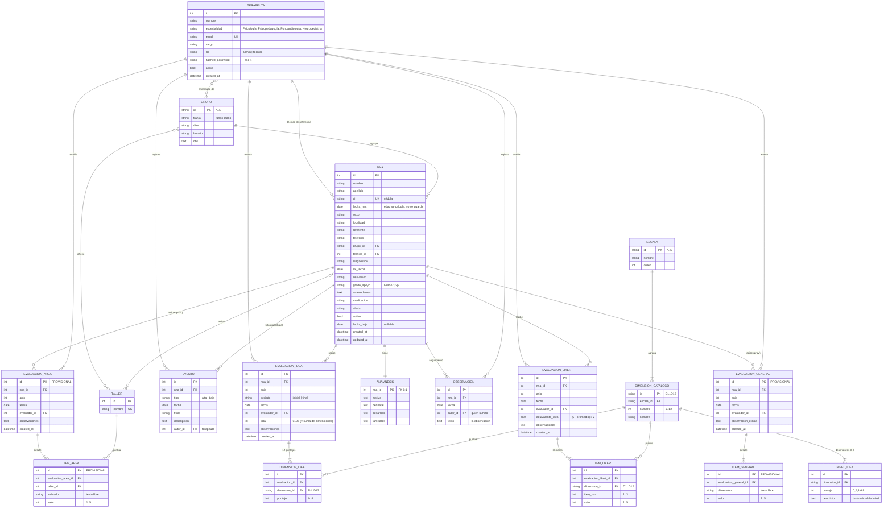

# Esquema de datos — HCE + IDEA (L1)

> ⚠️ **DOCUMENTO HISTÓRICO (esquema v1).** Describe el backend **retirado entero en M11.2**
> (2026-08-07): hablaba del modelo pre-Documento Técnico. El esquema vigente es
> **`esquema-datos-v2.md`**. Se conserva sólo como registro. Entre otras cosas, acá `grupo_id` es la
> letra del grupo; desde M12.1 es un entero y el nombre del grupo es el color (D9, `handoff.md` §5.18).

> **Estado:** propuesta para revisión (Fase 1). Derivada del modelo de dominio de la demo
> (`demo/hce_idea_ippu_demo.html`) y del protocolo IDEA (`docs/markdown/escala-del-inventario-del-espectro-autista-idea.md`).
> Motor: SQLite en dev → PostgreSQL en prod. Migraciones con Alembic.

## Diagrama ER

## Explicación en lenguaje simple

### ¿Qué tipo de esquema es?
Un **esquema relacional**: los datos viven en **tablas** (como planillas) que se **conectan entre sí** en vez de repetir información. La idea central es que **cada dato se guarda una sola vez, en su lugar**, y las demás tablas lo *referencian*. Ejemplo: el grupo "A" se describe una vez en `grupo`; cada NNA solo guarda "pertenezco al grupo A". Si cambia el horario del grupo, se corrige en un solo lugar.

### ¿Qué nivel de normalización tiene?
**Normalizar** = ordenar los datos para que no haya repeticiones ni contradicciones. Está en **3ª Forma Normal (3NF)**, el estándar sano. En criollo cumple tres reglas:
1. **Nada de "listas dentro de una celda":** los talleres de un NNA no son un texto `["Música","Arte"]` sino filas en una tabla puente; las 12 dimensiones del IDEA son 12 filas, no 12 columnas.
2. **Cada dato depende de la clave de su tabla:** una evaluación solo guarda "me evaluó el terapeuta N.º 3", no copia sus datos.
3. **No se guarda lo que se puede calcular:** no guardamos `edad` (se calcula desde `fecha_nac`).

**Excepción a propósito (denormalización controlada):** guardamos `total` (IDEA) y `equivalente_idea` (Likert) aunque son cálculos, para que informes y gráficos sean rápidos; la app los valida contra el detalle.

### ¿Cómo se conectan las tablas?
- **PK (clave primaria):** el "documento de identidad" único de cada fila (badge dorado).
- **FK (clave foránea):** un campo que **apunta** a la PK de otra tabla (badge verde, es la flecha).
- **Cardinalidad** (barra = "uno", pata de gallo = "muchos"):
  - **1:N** — un NNA tiene muchas evaluaciones; cada evaluación es de un solo NNA.
  - **1:1** — cada NNA tiene una anamnesis y viceversa.
  - **N:M** — un NNA va a muchos talleres y un taller tiene muchos NNA → se resuelve con una **tabla puente** (`nna_taller`). Por eso hay 3 tablas puente.

### Para qué sirve cada tabla
**Catálogo IDEA** (el "reglamento" del test, cargado una vez):
- `escala` — las 4 grandes áreas del IDEA (Relación Social, Comunicación, Anticipación, Simbolización).
- `dimension_catalogo` — las 12 dimensiones (D1–D12), cada una dentro de su escala.
- `nivel_idea` — el texto oficial de cada nivel de puntaje (0/2/4/6/8) de cada dimensión.

**Personas y estructura:**
- `terapeuta` — los profesionales; **también son los usuarios** que inician sesión.
- `grupo` — los grupos de referencia A–E (edad/modalidad, días, horario).
- `taller` — el catálogo de los 18 talleres.
- `terapeuta_grupo` · `grupo_taller` · `nna_taller` — tablas puente de los "muchos-a-muchos".

**NNA y clínica** (el corazón):
- `nna` — el **expediente** del niño/a (datos, diagnóstico, grupo, técnico, activo/inactivo).
- `anamnesis` — la historia de ingreso (motivo, perinatal, desarrollo, familiares). Una por NNA.
- `evento` — los **hitos** del expediente (alta, baja).
- `observacion` — el **diario de seguimiento** clínico: fecha, autor y texto (la pestaña "Observación").

**Evaluaciones** (registro del IDEA en el tiempo):
- `evaluacion_idea` — la "portada" de cada IDEA completa (enero/noviembre): año, período, evaluador, total.
- `dimension_idea` — el detalle: puntaje 0–8 de cada una de las 12 dimensiones (12 filas por evaluación).
- `evaluacion_likert` — la "portada" de la intermedia de junio: año, evaluador, equivalente IDEA.
- `item_likert` — el detalle: los 36 ítems (3 por dimensión, escala 1–5).

### La lógica de fondo
- **El expediente (`nna`) es el centro:** casi todo cuelga de ahí.
- **"Portada + detalle" en evaluaciones:** separar cabecera del renglón por dimensión permite análisis longitudinal ("¿cómo evolucionó la dimensión D5 en 3 años?").
- **El protocolo IDEA vive en la base, no en el código:** si IPPU ajusta un descriptor, se cambia el dato, no el programa.

---

## Tablas (resumen)

### Catálogo del protocolo IDEA (datos de referencia, se cargan por seed)
- **`escalas`** — 4 escalas (A Relación Social · B Comunicación y Lenguaje · C Anticipación/Flexibilidad · D Simbolización).
- **`dimensiones_catalogo`** — las 12 dimensiones D1–D12, cada una ligada a su escala.
- **`niveles_idea`** — descriptores oficiales por nivel (0/2/4/6/8) de cada dimensión. Es el texto que hoy está hardcodeado en la demo (`const DIMENSIONES`) y en `docs/markdown/`.

### Personas y estructura institucional
- **`terapeutas`** — profesional + evaluador + usuario de login (Fase 4). `rol` como columna.
- **`grupos`** — A–E (franja etaria, días, horario, observaciones).
- **`talleres`** — catálogo de los 18 talleres institucionales.
- Puentes M:N: **`terapeuta_grupo`** (encargados), **`grupo_taller`** (talleres del grupo), **`nna_taller`** (talleres que asiste el NNA).

### NNA y clínica
- **`nna`** — expediente. `grupo_id` y `tecnico_id` son FK (no strings).
- **`anamnesis`** — 1:1 con NNA (motivo, perinatal, desarrollo, familiares).
- **`evento`** — hitos administrativos del expediente (alta, baja).
- **`observacion`** — diario de seguimiento clínico: fecha, autor (quién la hizo) y texto. Es la pestaña "Observación" de la HCE.

### Evaluaciones
- **`evaluaciones_idea`** + **`dimensiones_idea`** — cabecera (año, periodo, evaluador, total) + 12 puntajes 0–8.
- **`evaluaciones_likert`** + **`items_likert`** — intermedia de junio: cabecera (equivalente IDEA) + 36 ítems (3 × 12 dim, escala 1–5).

## Fundamentación de las decisiones

1. **Las 12 dimensiones normalizadas** (`dimensiones_idea`) en vez de 12 columnas. Habilita consultas por dimensión (analítica L4, heatmaps escala×taller), validación uniforme 0–8 y evolución del protocolo sin `ALTER TABLE`. Costo: joins; correcto para análisis longitudinal.
2. **Protocolo IDEA data-driven** (`escalas`/`dimensiones_catalogo`/`niveles_idea`). Los descriptores oficiales viven en la BD, no hardcodeados en el front → una sola fuente de verdad para formularios, validación e informes; si IPPU ajusta un descriptor no se toca código.
3. **IDEA y Likert en tablas separadas.** Son dos instrumentos distintos (12 valores 0–8 vs 36 ítems 1–5); sólo se relacionan por el equivalente IDEA calculado `(5 − promedio) × 2`. Coincide con `evaluaciones_idea` / `items_likert` del handoff.
4. **`eventos` para el timeline clínico** (alta/nota/baja) separado de las evaluaciones. En la demo el `historial` mezcla notas y evaluaciones; acá las evaluaciones son entidades propias y el timeline del expediente se arma como *unión* de `eventos` + evaluaciones en la API → sin duplicar puntajes.
5. **`terapeutas` unifica profesional + evaluador + usuario.** Evita identidades duplicadas. `roles` del handoff se resuelve como columna `rol`; si crece a permisos finos, se promueve a tabla.
6. **Relaciones M:N explícitas** (nna–taller, grupo–taller, terapeuta–grupo). En la demo son arrays de strings; normalizarlas a catálogo + puente da integridad referencial y evita typos/duplicados.
7. **FK en vez de strings** para `grupo_id` y `tecnico_id`. Integridad y joins limpios.
8. **Claves únicas de negocio** del ciclo de evaluación: `(nna, año, periodo)` en IDEA y `(nna, año)` en Likert. Refleja "IDEA enero + noviembre, Likert junio" e impide duplicados.
9. **`activo` + `fecha_baja`** se preservan (distinción activos/inactivos de la demo v3.2).
10. **`created_at` / `updated_at`** para trazabilidad longitudinal, que es la meta central de L1.

## Evaluaciones provisionales (áreas y general)
Modeladas aparte del núcleo, con el mismo patrón portada+detalle, pero con **indicadores/dimensiones como texto libre** a propósito (el protocolo lo define IPPU y está en revisión):
- **`evaluacion_area` + `item_area`** — por cada taller que asiste el NNA, N indicadores (Likert 1–5). Fiel a la demo (3 indicadores genéricos por taller).
- **`evaluacion_general` + `item_general`** — dimensiones globales (Likert 1–5) + observación clínica. Fiel a la demo (5 dimensiones + texto).

> Al ser provisionales, sus indicadores son strings libres; cuando IPPU confirme el protocolo se normalizan con una nueva migración. No aparecen en el diagrama ER de arriba (que muestra el núcleo estable).

## Nota de implementación (Fase 1)
- **`total` y `equivalente_idea`** se guardan (denormalizados) por conveniencia de consulta, pero son **derivados** y la API los valida contra el detalle.
- **`nivel_idea`** (descriptores oficiales por nivel) carga su *estructura* en el seed; el **texto largo** de cada nivel se importa aparte desde `docs/markdown/escala-...idea.md` (pendiente, no bloquea).

## Datos derivados (no se guardan crudos)
- `nna.edad` → se calcula desde `fecha_nac`.
- `evaluaciones_idea.total` → suma de las 12 `dimensiones_idea` (se guarda validado).
- `evaluaciones_likert.equivalente_idea` → `(5 − promedio de ítems) × 2`.
